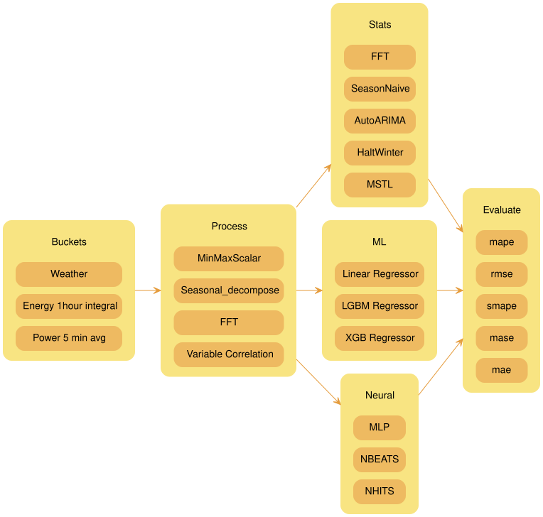

# Phisaver Project

Phisaver Project

Author

Benedict Thekkel

## Project Specifications

- Develop ML model to

  - Predict consumption
  - Detect anomalies
  - detect devices from using only the total power usage

- solar = func(future clouds, future sunlight, past three days)

- consumption = func(individual components, future weather, future humidity, past three days, past week, past month)

- aircon = func(future weather, future humidity, past three days)

## Data Strucuture

- Energy
  - 1 hour integral of power in kWh

  - 2021/04/01 - 2023/11/09
- Power
  - 5 mins average of Iotawatt
  - 2022/07/21 - 2023/11/09
- Iotawatt
  - 1 min average of sensor readings

## Frameworks

- Darts models : https://unit8co.github.io/darts/generated_api/darts.models.forecasting.html
- Nixtla models : https://nixtla.github.io/statsforecast/src/core/models.html
- sktime

## Models

`Auto Forecast`: Automatic forecasting tools search for the best parameters and select the best possible model for a series of time series. These tools are useful for large collections of univariate time series. Includes automatic versions of: Arima, ETS, Theta, CES.

`Exponential Smoothing`: Uses a weighted average of all past observations where the weights decrease exponentially into the past. Suitable for data with no clear trend or seasonality. Examples: SES, Holt’s Winters, SSO.

`Benchmark models`: classical models for establishing baselines. Examples: Mean, Naive, Random Walk

`Intermittent or Sparse models`: suited for series with very few non-zero observations. Examples: CROSTON, ADIDA, IMAPA

`Multiple Seasonalities`: suited for signals with more than one clear seasonality. Useful for low-frequency data like electricity and logs. Examples: MSTL.

`Theta Models`: fit two theta lines to a deseasonalized time series, using different techniques to obtain and combine the two theta lines to produce the final forecasts. Examples: Theta, DynamicTheta

### Statical

- AutoARIMA:
  - Automatically selects the best ARIMA (AutoRegressive Integrated Moving Average) model using an information criterion.
- HoltWinters:
  - Triple exponential smoothing, Holt-Winters’ method is an extension of exponential smoothing for series that contain both trend and seasonality.
- CrostonClassic as Croston:
- HistoricAverage: arthimetic mean
- DynamicOptimizedTheta as DOT:
  - The theta family of models has been shown to perform well in various datasets such as M3. Models the deseasonalized time series.
- SeasonalNaive:
  - Memory Efficient Seasonal Naive predictions
- MSTL
- FFT

### ML

- XGBRegressor

- LGBMRegressor

- LinearRegression

  - `target_transforms`: These are transformations applied to the target variable before model training and after model prediction. This can be useful when working with data that may benefit from transformations, such as log-transforms for highly skewed data.

  - `lags`: This parameter accepts specific lag values to be used as regressors. Lags represent how many steps back in time you want to look when creating features for your model. For example, if you want to use the previous day’s data as a feature for predicting today’s value, you would specify a lag of 1.

  - `lags_transforms`: These are specific transformations for each lag. This allows you to apply transformations to your lagged features.

    - expanding_mean
    - rolling_mean

  - `date_features`: This parameter specifies date-related features to be used as regressors. For instance, you might want to include the day of the week or the month as a feature in your model.

  - `num_threads`: This parameter controls the number of threads to use for parallelizing feature creation, helping to speed up this process when working with large datasets.

## Neural

- NBEATS
- NHITS
- MLP

Back to top
