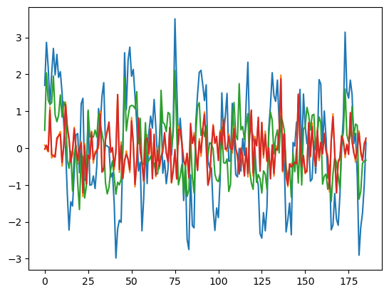

# FFT analysis

FFT Examples

Author

Benedict Thekkel

``` python
import pywt
import numpy as np
import pandas as pd
from sklearn.ensemble import RandomForestRegressor
from sklearn.metrics import mean_squared_error
import matplotlib.pyplot as plt
```

data = pd.read_csv(‘\<file’)

``` python
cycles = 26
weeks = cycles * 2
resolution = 7


np.random.seed(0)
t = np.linspace(0, cycles * np.pi, weeks * resolution)

waveform = np.random.normal(scale=0.5, size=len(t)) + 0.5 * np.sign(np.sin(0.67 * t))
y = np.sin(t) + 0.3*np.sin(4.71*t) + waveform
```

``` python
# Create a Pandas DataFrame
df = pd.DataFrame({'y': y})
df['unique_id'] = 1
```

``` python
rng = pd.date_range('04/01/2021', periods=df.shape[0], freq='D')
df['ds'] = rng
df.info()
```

    <class 'pandas.core.frame.DataFrame'>
    RangeIndex: 364 entries, 0 to 363
    Data columns (total 3 columns):
     #   Column     Non-Null Count  Dtype         
    ---  ------     --------------  -----         
     0   y          364 non-null    float64       
     1   unique_id  364 non-null    int64         
     2   ds         364 non-null    datetime64[ns]
    dtypes: datetime64[ns](1), float64(1), int64(1)
    memory usage: 8.7 KB

``` python
df_plot = df.copy()
df_plot.rename(columns={'y': 'final'}, inplace=True)
df_plot['unique_id'] = 'final'
df_plot['first'] = np.sin(t)
df_plot['second'] = 0.3*np.sin(5*t)
df_plot['noise'] = np.random.normal(scale=0.2, size=len(t))
df_plot.info()
```

    <class 'pandas.core.frame.DataFrame'>
    RangeIndex: 364 entries, 0 to 363
    Data columns (total 6 columns):
     #   Column     Non-Null Count  Dtype         
    ---  ------     --------------  -----         
     0   final      364 non-null    float64       
     1   unique_id  364 non-null    object        
     2   ds         364 non-null    datetime64[ns]
     3   first      364 non-null    float64       
     4   second     364 non-null    float64       
     5   noise      364 non-null    float64       
    dtypes: datetime64[ns](1), float64(4), object(1)
    memory usage: 17.2+ KB

``` python
import altair as alt

def long_form(df_plot):
    return df_plot.melt('ds', var_name='unique_id', value_name='price')

def altair_plot(df_plot): 
    highlight = alt.selection_point(on='mouseover', fields=['unique_id'], nearest=True)

    base = alt.Chart(df_plot).encode(
        x='ds:T',
        y='price:Q',
        color='unique_id:N'
    )

    points = base.mark_circle().encode(
        opacity=alt.value(0)
    ).add_params(
        highlight
    ).properties(
        width=1000
    )

    lines = base.mark_line().encode(
        size=alt.condition(~highlight, alt.value(1), alt.value(3))
    )

    return points + lines

df_plot = long_form(df_plot)
altair_plot(df_plot)
```

``` python
def wavelet_transform(data):
    transformed_data = []
    for column in data.columns:
        coeffs = pywt.wavedec(data[column], wavelet='db5', level=5)
        print(coeffs)
        transformed_data.extend(coeffs)
        
    return transformed_data
```

``` python
y = pd.DataFrame(df['y'])
#y['second'] = waveform
y.columns
```

    Index(['y'], dtype='object')

``` python
X_wavelet = wavelet_transform(y)
```

    [array([ 8.56037363,  8.28015354,  8.60255108,  8.33149856,  8.73389978,
            7.74524132, 10.2828375 ,  2.1141299 , -1.18795588,  0.44417908,
            1.19875776,  0.03718912, -0.69022103,  0.39696723, -0.92086484,
            0.09806285, -0.67200673,  0.71120904, -4.05185514, -4.04591833]), array([ 0.01153199, -0.25139026,  0.08876349,  1.32828559,  0.07565752,
            2.63863482,  4.79537636, -1.24767023, -5.54718816, -3.35555816,
            2.36944361,  4.04646868,  0.87187567, -1.68265763,  1.33179388,
           -0.40272217,  0.55708821, -1.64304018,  2.00581003, -2.03032757]), array([-0.08897953, -0.4812266 , -0.50538909, -0.10168253, -2.61150232,
            2.9547261 , -2.29803229, -0.09763533,  1.47903615, -2.54419368,
            3.62531102, -2.47650808,  2.5678546 , -1.85454489, -0.19285758,
            1.37250574, -1.5142747 ,  2.39190732, -3.19870564,  2.72915131,
           -3.41889537,  1.28809091,  0.52633798, -1.98882932,  3.88974806,
           -5.33502469,  0.91456006,  0.25339818,  3.80649291, -3.62508319,
            2.3555905 ]), array([ 0.04489604,  1.21115553,  0.30484212,  0.57478063, -0.10751276,
           -0.65589434,  1.54087004,  0.69994033,  0.84825601, -0.01101841,
            0.19981331,  0.33554834, -0.29570558,  1.92260008, -0.8211238 ,
            0.16218484,  1.10221247, -0.2672678 , -0.39443262, -0.74778196,
           -0.16734269, -1.55505881, -0.16445345, -1.09477366, -0.2275783 ,
           -0.32740859,  0.09258987,  1.32728503, -1.59283858,  0.0304181 ,
           -0.04143611, -0.06468654,  0.42971042,  0.40445104,  1.32661766,
           -0.68588646,  0.56466584,  0.13326441, -0.17115911,  0.37710454,
           -0.13755441,  1.21737271, -0.55018683, -0.22723865, -0.66991994,
            0.08144042, -0.09456927, -0.88110325,  0.89665126, -1.27621373,
            2.02092779, -0.82140168, -0.28145005]), array([ 0.08743568, -0.52802978,  0.76003102, -0.87477212, -0.2137142 ,
           -0.08251688,  0.22470448, -0.24951939, -0.41966809,  0.24968052,
           -0.82965552,  0.11282229,  0.41979293, -1.62165521,  0.63917665,
           -0.05349559, -0.81191952,  0.47499175,  0.4483338 , -0.51529357,
           -0.03268174,  0.81509277, -0.72212797,  0.94142773,  0.79246556,
           -0.66823467, -0.04388327, -0.35251386, -0.96690333,  0.76438364,
            0.61711505, -0.57417453, -0.24123739,  0.47541282, -1.33055547,
           -0.04216579,  0.49976061, -0.04719167, -1.45547177,  1.4612047 ,
           -1.09233401, -0.79218819,  1.4451979 , -0.52280188, -0.51661146,
            0.07177687, -0.06904092, -1.00303966,  0.54283863, -0.20346968,
           -0.44556147,  1.01559998,  0.21400751, -1.02416331,  1.15926639,
           -0.56999735,  0.65632908,  0.4355802 ,  0.48993803, -1.39774935,
            0.38826329, -0.33822322, -0.40172831,  0.53523861, -0.09876577,
           -0.53922567, -0.34208739,  0.67681303,  0.09242104, -0.10293512,
            0.68052398, -1.18565793, -0.6305652 , -0.08625569, -1.3032623 ,
           -0.4577607 ,  0.47035347,  0.05809923, -0.89829346,  0.82602796,
           -1.07480685, -0.05684645,  0.80296313,  0.22276104, -0.67154841,
            0.41031737, -0.54248432, -1.24758935,  0.81923313, -0.76539182,
           -0.06074858,  0.97558165, -0.34115139, -0.11998139,  0.21528626,
           -0.60822975,  0.00416824]), array([ 7.82169804e-02, -2.12160997e-02, -1.02848006e-01,  1.11393225e+00,
           -2.69082443e-01, -1.98484826e-01, -1.71201044e-01,  1.81663044e-01,
            3.49069262e-01,  4.45396733e-01, -4.88410641e-01,  1.15788613e-01,
            1.24733049e+00,  4.99264605e-01,  2.69837665e-01, -3.29457397e-01,
           -1.78566872e-01,  5.62829176e-01,  1.68993607e-02, -4.34187851e-01,
            3.75604438e-02,  1.78940706e-01, -1.31556512e+00,  1.27625750e-01,
           -9.41784192e-01, -2.90424465e-01, -2.28643513e-01,  4.58050195e-01,
           -4.08033755e-01, -9.86955101e-02, -5.20036649e-02, -3.78122379e-04,
            9.93916246e-01, -6.37854384e-01, -6.25300155e-01,  2.95068950e-01,
            4.62356890e-01,  6.19277900e-01, -3.45611868e-02,  1.00372393e-02,
           -5.87213878e-01, -2.39389518e-02,  1.44606100e+00, -6.61582418e-01,
            1.63701508e-01, -8.32121441e-01, -3.99609990e-01, -7.81021937e-02,
           -3.17109338e-01, -6.62768834e-01,  8.28543671e-01,  1.12792812e-01,
           -1.05304001e+00, -2.86248468e-01,  7.85163687e-01, -1.14392546e-01,
           -3.22477044e-01, -9.26960676e-01,  1.51314348e-01,  3.69942059e-01,
           -1.91301182e-01,  4.69421895e-01, -7.35694506e-01,  3.20851631e-01,
           -7.78526682e-01,  3.67410679e-02, -5.64428095e-01, -2.68241703e-01,
           -2.10079402e-03,  3.51694972e-01, -1.49792951e-01, -2.97840420e-01,
            4.72250268e-01, -9.50879824e-01, -5.42413251e-01, -1.15215252e-01,
           -8.46279893e-01,  5.97270295e-01,  4.20475483e-01,  1.18398345e-01,
           -2.68442902e-01, -5.38487858e-01, -1.44555769e-01, -7.29126413e-01,
            5.81750516e-01,  1.31050332e-01,  4.13242858e-01, -1.69833616e-01,
           -5.93391260e-01,  2.54453871e-01, -2.24416337e-01,  5.22312215e-01,
            9.80914799e-01, -1.45058262e-02, -9.80040422e-01, -7.46969348e-01,
           -7.80924496e-02,  6.39680098e-01,  1.83881590e-01,  2.19077815e-01,
           -2.97418275e-01,  4.84247670e-01, -1.16957224e-02,  8.16785915e-01,
            5.63532338e-03, -9.60587176e-02,  3.83645651e-01,  2.16475782e-02,
           -1.36875879e-01,  5.94808227e-01,  5.22964942e-03, -2.75391075e-01,
           -6.37982756e-01,  8.51258601e-03, -3.16836196e-01, -6.85667705e-01,
            1.08353986e-02, -7.82748435e-01,  4.28636022e-01,  1.03055876e+00,
           -7.63941608e-01,  3.20021138e-01,  6.56538023e-02,  7.50973676e-01,
           -5.42819573e-01,  6.88499408e-01, -2.69482031e-01,  4.58058772e-01,
           -3.65725409e-01, -7.34325562e-02, -7.43466155e-01,  6.62097224e-02,
           -7.63881741e-01,  7.13215259e-02, -7.17346313e-02,  3.79695244e-01,
            1.97768780e+00, -6.49823532e-01,  3.26231535e-01, -6.76495937e-01,
           -1.04392496e+00, -4.81300683e-01, -4.17198698e-01, -4.93617859e-01,
           -4.36926650e-01, -3.29281763e-01,  1.40802817e+00,  1.33180958e-01,
           -4.08391392e-01, -2.60750946e-01, -7.00602812e-01, -5.40610047e-01,
            6.22860442e-01, -2.48715379e-01,  6.80335666e-01, -2.22681683e-01,
           -5.17525473e-01,  5.61675223e-01, -3.38477480e-01,  1.43883793e-01,
           -6.74863552e-02,  3.17695822e-01, -7.23998209e-02, -1.88063003e-01,
           -1.19267630e+00,  2.18871157e-01,  9.27703437e-01, -1.90193785e-01,
           -1.21027604e+00, -3.24657030e-01, -3.35131838e-01,  3.43673865e-01,
            2.20526430e-01, -2.57544687e-01,  1.10155401e-01, -1.05068944e-01,
            8.65358978e-01,  2.03499300e-01, -7.50242361e-02, -3.86384134e-01,
           -7.66133144e-03,  4.64230598e-01, -1.63102790e-01, -3.32783358e-01,
            1.55127572e-01,  2.00635763e-01])]

``` python
X_wavelet[0]
```

    array([ 1.69782638e+00,  2.86633130e+00,  2.19476886e+00,  1.17397138e+00,
            2.01586836e+00,  2.70074412e+00,  1.98287045e+00,  2.53977548e+00,
            1.91548731e+00,  2.07104557e+00,  1.49206799e+00,  6.24585355e-01,
            3.63488119e-03, -1.23050798e+00, -2.22516777e+00, -1.45626892e+00,
           -1.57360056e+00, -6.70425537e-01,  3.60216320e-01,  3.92006830e-01,
           -6.67448566e-01,  1.20076474e+00,  1.34902772e+00, -8.80108851e-01,
           -8.48793754e-01,  9.86961240e-01, -1.00889684e+00, -9.96228925e-01,
           -7.58473590e-01, -1.09936767e+00, -4.74542101e-01,  1.07154093e+00,
            6.71358965e-01,  1.41619721e+00,  1.77307686e+00,  7.40809286e-02,
            5.62297202e-02,  1.48342153e-02, -7.92568112e-01, -6.72164798e-01,
           -1.47818506e+00, -2.98386840e+00, -2.19059661e+00, -1.95613078e+00,
           -2.01711333e+00, -7.02480981e-04,  2.58409010e+00,  1.03976676e+00,
            2.38187317e+00,  2.73694743e+00,  1.94806995e+00,  2.13110002e+00,
            1.41275222e+00,  6.61209183e-01, -6.26994065e-01, -3.83339616e-01,
           -2.24552771e+00, -1.36530903e+00,  5.20891491e-02, -9.63966984e-01,
            4.33903511e-01,  8.65625523e-01,  5.39747879e-01,  1.31753836e+00,
            5.60365478e-01, -3.40131488e-01,  1.80168614e-01,  1.10758938e+00,
           -6.84122197e-01, -3.34468694e-01, -9.67974799e-01, -5.68087480e-01,
            5.62314033e-01, -1.94723399e-01,  5.90536838e-01,  3.50383895e+00,
            1.71759551e+00,  9.24381133e-02,  8.06891772e-01,  1.74700310e-01,
           -1.42390185e+00, -5.70536402e-01, -2.47344630e+00, -2.75288846e+00,
           -7.27528289e-01, -2.10474614e+00, -2.16611230e+00,  6.83276964e-01,
            1.45111868e+00,  2.05263083e+00,  2.10768670e+00,  1.71995702e+00,
            1.28707724e+00,  1.71366022e+00, -3.45686267e-01, -5.42679676e-01,
           -5.36517797e-01, -1.64763345e+00, -2.23588848e+00, -1.62481503e+00,
           -1.88789349e+00, -8.67276586e-01,  1.49540135e+00,  3.48492854e-01,
            8.75034108e-01,  1.48134970e+00, -3.57533461e-01, -3.50851776e-01,
            1.21067431e+00,  3.34407247e-01, -7.22731370e-01, -7.83948722e-01,
           -8.00539078e-03, -6.27089015e-01,  2.58212559e-01, -2.01821012e-01,
            1.25658523e+00,  2.32748366e+00,  3.63168070e-01,  5.26949190e-01,
            3.16572282e-01,  6.48425185e-03, -7.71003662e-01, -1.01376207e+00,
           -2.32236401e+00, -2.44432130e+00, -1.75157248e+00, -2.24439864e+00,
           -1.59672927e+00,  5.30976701e-01,  1.14611200e+00,  2.04313147e+00,
            1.41599179e+00,  1.26529130e+00,  1.84280178e+00,  6.76185118e-01,
            4.80539100e-01,  3.72875688e-01, -4.81506716e-01, -2.27614039e+00,
           -1.94089445e+00, -1.49267556e+00, -2.35262541e+00,  1.51879060e-01,
            4.85279258e-02,  6.93119371e-01,  7.50628470e-01,  1.58969214e+00,
           -2.73848686e-01,  1.46411682e+00,  5.94325381e-01,  1.20018857e-01,
            1.42775133e-01, -9.01552690e-01, -8.36577719e-01,  1.87829611e-01,
           -6.83570959e-01,  9.44528652e-02,  1.85610930e+00,  1.72844555e+00,
            9.30680887e-02,  1.00389764e+00,  2.83265909e-01, -8.17614709e-01,
           -4.59295934e-01, -2.21982178e+00, -2.08909812e+00, -1.23495410e+00,
           -1.92722736e+00, -2.09438316e+00, -1.27483495e+00,  2.47151395e-02,
            8.62875878e-01,  3.14299902e+00,  1.53494389e+00,  1.35202124e+00,
            1.84182300e+00,  1.45584181e+00,  1.20316826e-01,  3.96518649e-01,
           -7.89934160e-01, -2.90731899e+00, -2.14249061e+00, -1.76722203e+00,
           -1.01628309e+00,  1.55622881e-01])

``` python
plt.plot(X_wavelet[0])
plt.plot(X_wavelet[1])
plt.plot(X_wavelet[2])
plt.plot(X_wavelet[3])
```



``` python
X_wavelet
```

    ---------------------------------------------------------------------------
    AttributeError                            Traceback (most recent call last)
    Cell In[56], line 1
    ----> 1 X_wavelet.info()

    AttributeError: 'numpy.ndarray' object has no attribute 'info'

``` python
split_point = int(len(data) * 0.8)
```

    ---------------------------------------------------------------------------
    NameError                                 Traceback (most recent call last)
    Cell In[54], line 1
    ----> 1 split_point = int(len(data) * 0.8)

    NameError: name 'data' is not defined

``` python
X_train, X_data = X_wavelet[:split_point], X_wavelet[split_point:, :]
y_train, y_test = y.iloc[:split_point], y.iloc[split_point:]
```

``` python
model = RandomForestRegressor()
model.fit(X_train, y_train)
```

Back to top
