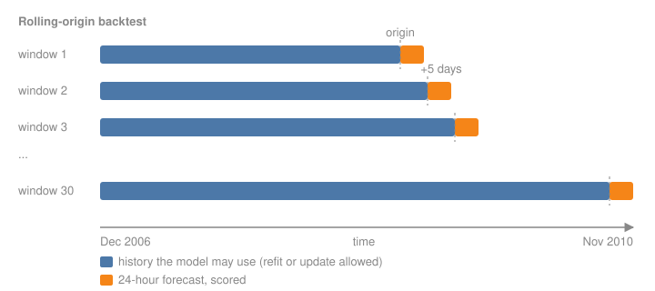

# Backtesting and Leakage

The rolling-origin backtest every forecasting page on this site is scored with, and five ways a forecast evaluation leaks the future into the past.

Author

Benedict Thekkel

## Why a forecast needs its own evaluation

A forecast is used at one moment, with only the past available. An honest evaluation must recreate that moment many times: pick a point in time (the **origin**), give the model only the data before it, ask for the next 24 hours, and score the answer against what actually happened. Repeat for many origins and average.

This is a **rolling-origin backtest**. The ordinary machine learning recipe (shuffle the rows, hold out 20%) breaks it, because a shuffled test row has its own neighbours, one hour before and one hour after, in the training set. The model then interpolates instead of forecasting. Section 5 measures how much that flatters the score.



Rolling-origin backtest

------------------------------------------------------------------------

## 1. The protocol

Every single-series page uses the same protocol, so scores compare across pages:

| Setting | Value | Why |
|----|----|----|
| Target | hourly household energy, kWh (gap-filled) | the [Datasets](../01_Foundations/datasets.llms.md) page |
| Horizon | 24 hours from midnight | a day-ahead forecast, the common operational case |
| Windows | 30 origins, 5 days apart | 5 and 7 share no factor, so the origins cycle through every weekday |
| Test span | the last 150 days (late June to late November 2010) | summer into winter, with the annual peak just starting |
| History | everything before the origin | a model may refit at each origin or train once before the first |
| Scored hours | only hours the meter recorded | 49 of the 720 test hours were gap-filled (one whole day copied from the week before); they are forecast but not scored, because a forecast scored against a copy of last week rewards any model that copies last week |

Excluding the filled hours matters more than it sounds. Scored against all 720 hours, repeating last week earns +2% skill against repeating yesterday; scored only on recorded hours, it earns -4.5%. One gap-filled day, copied from the week before, was worth six points to any model that copies last week. That is a sixth leak, through the data preparation rather than the model.

The test span covers one part of the year only. A model that is good in summer and bad in winter will look better than it is. That is a known limit of this protocol, accepted to keep runs short.

------------------------------------------------------------------------

------------------------------------------------------------------------

[source](https://github.com/bthek1/ML_Timeseries/blob/main/ML_Timeseries/backtest.py#L28)

### origins

``` python
def origins(
    index:pandas.core.indexes.datetimes.DatetimeIndex, horizon:int=24, n_windows:int=30, step:int=120
)->list[int]:
```

*Positions of the forecast origins: `n_windows` midnights `step` apart, the last one at least `horizon` before the end.*

## 2. Running a backtest

A **forecaster** is any function `f(history, horizon)` that returns `horizon` numbers. `history` is a `pd.Series` that ends one step before the origin, so a forecaster cannot see the future even by mistake. [`backtest`](https://bthek1.github.io/ML_Timeseries/02_Evaluation/backtesting.html#backtest) calls it once per origin and returns one row per forecast hour.

[`future_index`](https://bthek1.github.io/ML_Timeseries/02_Evaluation/backtesting.html#future_index) gives the timestamps a forecaster is asked about, for models that need calendar features.

------------------------------------------------------------------------

------------------------------------------------------------------------

[source](https://github.com/bthek1/ML_Timeseries/blob/main/ML_Timeseries/backtest.py#L48)

### backtest

``` python
def backtest(
    y:pandas.core.series.Series, forecaster:Callable[[pandas.core.series.Series, int], numpy.ndarray],
    horizon:int=24, n_windows:int=30, step:int=120
)->pandas.core.frame.DataFrame:
```

*Rolling-origin backtest: one row per (window, forecast hour) with `y` and `yhat`. Total seconds in `.attrs`.*

------------------------------------------------------------------------

[source](https://github.com/bthek1/ML_Timeseries/blob/main/ML_Timeseries/backtest.py#L42)

### future_index

``` python
def future_index(
    history:pandas.core.series.Series, horizon:int
)->pandas.core.indexes.datetimes.DatetimeIndex:
```

*The `horizon` timestamps after the end of `history`.*

## 3. The reference: seasonal naive

The **seasonal naive** forecast repeats the last observed season: tomorrow at 18:00 equals today at 18:00. It costs nothing, and it is the bar every other model must clear. A model that cannot beat it has learned nothing useful about the series.

------------------------------------------------------------------------

------------------------------------------------------------------------

[source](https://github.com/bthek1/ML_Timeseries/blob/main/ML_Timeseries/backtest.py#L66)

### seasonal_naive

``` python
def seasonal_naive(
    m:int=24
)->Callable[[pandas.core.series.Series, int], numpy.ndarray]:
```

*Forecaster that repeats the last `m` observations.*

## 4. Scores

The [Forecast Metrics](../02_Evaluation/forecast_metrics.llms.md) page explains each metric and when it misleads. [`score`](https://bthek1.github.io/ML_Timeseries/02_Evaluation/backtesting.html#score) reports all of them for one backtest:

- **MASE** (mean absolute scaled error) is the headline. It divides each window’s mean absolute error by the mean absolute error of the seasonal naive forecast *inside that window’s history*. Below 1 means better than seasonal naive was on the past.
- **Skill** is `1 - MAE / MAE(seasonal naive)` on the *same test windows*. Positive means the model beat the reference where it mattered; 0.2 means 20% less error.

`exclude` takes a boolean series (the loader’s `filled` flag) and drops those hours from every metric, for the model and the reference alike.

------------------------------------------------------------------------

------------------------------------------------------------------------

[source](https://github.com/bthek1/ML_Timeseries/blob/main/ML_Timeseries/backtest.py#L114)

### score

``` python
def score(
    bt:pandas.core.frame.DataFrame, y:pandas.core.series.Series, m:int=24,
    exclude:pandas.core.series.Series | None=None
)->dict:
```

*MAE, RMSE, WAPE, sMAPE, MASE and skill against seasonal naive; rows where `exclude` is True are not scored.*

------------------------------------------------------------------------

[source](https://github.com/bthek1/ML_Timeseries/blob/main/ML_Timeseries/backtest.py#L108)

### mase_scale

``` python
def mase_scale(
    y:pandas.core.series.Series, m:int=24
)->pandas.core.series.Series:
```

*For each position, the in-sample seasonal naive MAE of everything before it.*

------------------------------------------------------------------------

[source](https://github.com/bthek1/ML_Timeseries/blob/main/ML_Timeseries/backtest.py#L99)

### smape

``` python
def smape(
    y, yhat
)->float:
```

*Symmetric MAPE in \[0, 2\]; a 0/0 term counts as 0.*

------------------------------------------------------------------------

[source](https://github.com/bthek1/ML_Timeseries/blob/main/ML_Timeseries/backtest.py#L91)

### mape

``` python
def mape(
    y, yhat
)->float:
```

*Mean absolute percentage error; infinite when any actual is 0.*

------------------------------------------------------------------------

[source](https://github.com/bthek1/ML_Timeseries/blob/main/ML_Timeseries/backtest.py#L85)

### wape

``` python
def wape(
    y, yhat
)->float:
```

*Weighted absolute percentage error: total absolute error over total actual.*

------------------------------------------------------------------------

[source](https://github.com/bthek1/ML_Timeseries/blob/main/ML_Timeseries/backtest.py#L80)

### rmse

``` python
def rmse(
    y, yhat
)->float:
```

*Root mean squared error.*

------------------------------------------------------------------------

[source](https://github.com/bthek1/ML_Timeseries/blob/main/ML_Timeseries/backtest.py#L75)

### mae

``` python
def mae(
    y, yhat
)->float:
```

*Mean absolute error.*

## 5. The scoreboard file

[`record`](https://bthek1.github.io/ML_Timeseries/02_Evaluation/backtesting.html#record) writes one JSON file per model to `nbs/results/`. The [Scoreboard](../02_Evaluation/scoreboard.llms.md) page reads them all into one table. One file per model, not one shared CSV, because `nbdev-test` runs notebooks in parallel and two writers to one file would corrupt it.

------------------------------------------------------------------------

------------------------------------------------------------------------

[source](https://github.com/bthek1/ML_Timeseries/blob/main/ML_Timeseries/backtest.py#L148)

### load_results

``` python
def load_results()->pandas.core.frame.DataFrame:
```

*All scoreboard rows, best MASE first within each dataset.*

------------------------------------------------------------------------

[source](https://github.com/bthek1/ML_Timeseries/blob/main/ML_Timeseries/backtest.py#L139)

### record

``` python
def record(
    model:str, family:str, scores:dict, notebook:str, dataset:str='household', notes:str=''
)->dict:
```

*Write one scoreboard row to `results/<dataset>_<model>.json` and return it.*

------------------------------------------------------------------------

[source](https://github.com/bthek1/ML_Timeseries/blob/main/ML_Timeseries/backtest.py#L128)

### results_dir

``` python
def results_dir()->pathlib.Path:
```

*The `results` folder next to `nbdev.yml`, found by walking up from the working directory.*

## 6. The first scoreboard row

Seasonal naive with a 24-hour season goes first. Every later page is measured against it.

------------------------------------------------------------------------

``` python
from ML_Timeseries.data import load_household, line_chart, show
```

``` python
hh = load_household()
y, FILLED = hh["kwh"], hh["filled"]
bt = backtest(y, seasonal_naive(24))
snaive = score(bt, y, exclude=FILLED)
record("Seasonal naive (24 h)", "baseline", snaive, notebook="02_Evaluation/00_Backtesting")
pd.Series(snaive).round(3)
```

    mase       0.816
    skill      0.000
    mae        0.523
    rmse       0.809
    wape       0.577
    smape      0.501
    seconds    0.001
    dtype: float64

The last window shows what the reference does: it copies yesterday’s shape exactly, including its peaks, whether or not today repeats them.

``` python
last = bt[bt.window == bt.window.max()]
show(line_chart(last.ds.dt.strftime("%a %H:00"), {"actual": last.y, "seasonal naive": last.yhat}, y_name="kWh", height="320px", zoom=False))
```

## 7. Five ways an evaluation leaks

Each example builds a gradient-boosted tree model (scikit-learn’s `HistGradientBoostingRegressor`) twice: once with the bug, once without. The bug always makes the score look better. That is what makes leakage dangerous: nothing fails, the number just improves.

The honest model uses only features that exist at the origin:

- lags of 24, 25, 48, 168 and 336 hours (every lag is at least the 24-hour horizon, so its value is known before the forecast starts);
- hour of day and day of week.

It trains once on everything before the first origin.

------------------------------------------------------------------------

``` python
from sklearn.ensemble import HistGradientBoostingRegressor
from sklearn.model_selection import KFold, cross_val_score

from threadpoolctl import threadpool_limits

# nbdev-test runs pages in parallel; per-page OpenMP pools on 4 cores made the gradient-boosting pages 30x slower.
_ = threadpool_limits(1)
```

``` python
SAFE_LAGS = [24, 25, 48, 168, 336]


def features(s: pd.Series, lags=SAFE_LAGS, extra: dict | None = None) -> pd.DataFrame:
    X = pd.DataFrame({f"lag{l}": s.shift(l) for l in lags}, index=s.index)
    X["hour"], X["dow"] = s.index.hour, s.index.dayofweek
    for k, v in (extra or {}).items():
        X[k] = v
    return X


def gbm(**kw):
    return HistGradientBoostingRegressor(max_iter=200, learning_rate=0.08, random_state=0, **kw)


cut = origins(y.index)[0]
train_y = y.iloc[:cut]


def honest_forecaster(model, make_features):
    "Forecast by computing features on history plus an empty future, so no future value can leak in."
    def f(history, horizon):
        ext = pd.concat([history, pd.Series(np.nan, index=future_index(history, horizon))])
        return model.predict(make_features(ext).iloc[-horizon:])
    return f


scored_ds = bt.ds[~FILLED.reindex(bt.ds).to_numpy()].to_numpy()


def test_rows_mae(model, X_full):
    "The buggy way: build features on the whole series, then score the test rows."
    p = model.predict(X_full)
    idx = scored_ds
    return mae(y.loc[idx], pd.Series(p, index=y.index).loc[idx])


X_train = features(train_y).iloc[336:]
base = gbm().fit(X_train, train_y.iloc[336:])
honest_bt = backtest(y, honest_forecaster(base, features))
honest = score(honest_bt, y, exclude=FILLED)
print(f"honest gradient boosting: MAE {honest['mae']:.3f}, skill {honest['skill']:+.1%}")
```

    honest gradient boosting: MAE 0.464, skill +11.1%

### Bug 1: shuffled cross-validation

The model is scored with 5-fold cross-validation on shuffled training rows. Each held-out hour has its neighbours in the training folds.

**Fix**: score with the rolling-origin backtest.

``` python
cv_mae = -cross_val_score(gbm(), X_train, train_y.iloc[336:], cv=KFold(5, shuffle=True, random_state=0),
                          scoring="neg_mean_absolute_error").mean()
leaks = [{"bug": "1. shuffled cross-validation", "leaky MAE": cv_mae, "honest MAE": honest["mae"]}]
print(f"shuffled CV MAE {cv_mae:.3f} vs backtest MAE {honest['mae']:.3f}")
```

    shuffled CV MAE 0.493 vs backtest MAE 0.464

Here the shuffled score is *worse*, not better. The two numbers measure different periods: cross-validation averages over four years including the winters, and the backtest covers summer and autumn, when consumption is lower and easier. So comparing the two tells you nothing, which is the point. A shuffled score cannot even be compared with the real one.

The honest comparison holds the period fixed: train on the same rows, then score the backtest’s own test hours by shuffled cross-validation over *all* rows including the test period.

``` python
X_all = features(y).iloc[336:]
y_all = y.iloc[336:]
test_mask = X_all.index.isin(scored_ds)
oof = np.zeros(len(X_all))
for tr, te in KFold(5, shuffle=True, random_state=0).split(X_all):
    oof[te] = gbm().fit(X_all.iloc[tr], y_all.iloc[tr]).predict(X_all.iloc[te])
cv_test_mae = mae(y_all[test_mask], oof[test_mask])
leaks[0]["leaky MAE"] = cv_test_mae
print(f"shuffled CV on the test hours: MAE {cv_test_mae:.3f} vs backtest MAE {honest['mae']:.3f}")
```

    shuffled CV on the test hours: MAE 0.453 vs backtest MAE 0.464

On the same hours, shuffling flatters the score, but only by a few percent. The leak is small here because no feature is closer than 24 hours, so a test hour’s direct neighbours never appear as inputs. Add `lag1` to the features (as most tutorials do) and shuffled cross-validation scores the model on interpolation instead, which bug 2 shows is worth about 30%.

### Bug 2: lags shorter than the horizon

`lag1` (the previous hour) is the strongest feature any hourly model can have. For a 24-hour forecast it exists only for the first hour; for hour 18 it would be the value at hour 17, which is still in the future at the origin. Building the feature table on the whole series and then splitting hands the model those future values.

**Fix**: use only lags of at least the horizon, or forecast recursively and feed predictions back in.

``` python
short = lambda s: features(s, lags=[1, 2, 3] + SAFE_LAGS)
m2 = gbm().fit(short(train_y).iloc[336:], train_y.iloc[336:])
leaky2 = test_rows_mae(m2, short(y))
honest2 = score(backtest(y, honest_forecaster(m2, short)), y, exclude=FILLED)["mae"]
leaks.append({"bug": "2. lags shorter than the horizon", "leaky MAE": leaky2, "honest MAE": honest2})
print(f"lag1-3 with future values: MAE {leaky2:.3f}; same model with only the past: MAE {honest2:.3f}")
```

    lag1-3 with future values: MAE 0.325; same model with only the past: MAE 0.467

### Bug 3: a rolling window that includes the target

`s.rolling(24).mean()` at hour *t* averages hours *t-23* to *t*, so it contains the value being predicted. This is the most common leak in feature engineering code, because pandas aligns the window to its right edge by default.

**Fix**: shift by the horizon before rolling: `s.shift(24).rolling(24).mean()`.

``` python
roll_leak = lambda s: features(s, extra={"roll24": s.rolling(24).mean()})
roll_safe = lambda s: features(s, extra={"roll24": s.shift(24).rolling(24).mean()})
m3 = gbm().fit(roll_leak(train_y).iloc[336:], train_y.iloc[336:])
leaky3 = test_rows_mae(m3, roll_leak(y))
m3s = gbm().fit(roll_safe(train_y).iloc[336:], train_y.iloc[336:])
honest3 = score(backtest(y, honest_forecaster(m3s, roll_safe)), y, exclude=FILLED)["mae"]
leaks.append({"bug": "3. rolling mean includes the target", "leaky MAE": leaky3, "honest MAE": honest3})
print(f"unshifted rolling mean: MAE {leaky3:.3f}; shifted: MAE {honest3:.3f}")
```

    unshifted rolling mean: MAE 0.403; shifted: MAE 0.453

### Bug 4: a statistic computed on the whole series

An hour-of-week profile (the average consumption for each of the 168 hours of the week) is a strong feature. Computed over the whole series, it includes the test period’s own average, which is information about the answers.

**Fix**: compute every statistic, scaler and encoder on the training rows only.

``` python
how = lambda idx: idx.dayofweek * 24 + idx.hour
prof_all = y.groupby(how(y.index)).mean()
prof_train = train_y.groupby(how(train_y.index)).mean()
prof_feat = lambda prof: (lambda s: features(s, extra={"profile": prof.reindex(how(s.index)).to_numpy()}))
m4 = gbm().fit(prof_feat(prof_all)(train_y).iloc[336:], train_y.iloc[336:])
leaky4 = test_rows_mae(m4, prof_feat(prof_all)(y))
m4s = gbm().fit(prof_feat(prof_train)(train_y).iloc[336:], train_y.iloc[336:])
honest4 = score(backtest(y, honest_forecaster(m4s, prof_feat(prof_train))), y, exclude=FILLED)["mae"]
leaks.append({"bug": "4. statistic computed on all data", "leaky MAE": leaky4, "honest MAE": honest4})
print(f"profile from all data: MAE {leaky4:.3f}; from training only: MAE {honest4:.3f}")
```

    profile from all data: MAE 0.462; from training only: MAE 0.462

The leak is almost invisible here, because the test period is only 150 of about 1,440 days, so it barely moves a four-year average. The same bug is serious when the test period is a large share of the data, or when the statistic tracks a trend (a min-max scaler on a growing series, for example).

### Bug 5: tuning on the test windows

Six settings of the model are tried, and the one with the lowest backtest score is reported. That score is optimistic: the choice itself used the test data. With enough settings, a lucky one always wins.

**Fix**: choose on validation windows that end before the first test origin, then score the chosen setting once on the test windows.

``` python
grid = [dict(max_iter=it, learning_rate=lr) for it in (50, 200, 600) for lr in (0.03, 0.15)]
val_y = y.iloc[:cut]
fit_cut = origins(val_y.index)[0]


def fit_eval(params, series, cut_at):
    m = HistGradientBoostingRegressor(random_state=0, **params).fit(features(series.iloc[:cut_at]).iloc[336:], series.iloc[336:cut_at])
    return m


def observed_mae(b):
    b = b[~FILLED.reindex(b.ds).to_numpy()]
    return mae(b.y, b.yhat)


test_scores = [observed_mae(backtest(y, honest_forecaster(fit_eval(p, y, cut), features))) for p in grid]
val_scores = [observed_mae(backtest(val_y, honest_forecaster(fit_eval(p, val_y, fit_cut), features))) for p in grid]
leaky5, honest5 = min(test_scores), test_scores[int(np.argmin(val_scores))]
leaks.append({"bug": "5. tuning on the test windows", "leaky MAE": leaky5, "honest MAE": honest5})
print(f"best of {len(grid)} on test: MAE {leaky5:.3f}; chosen on validation: MAE {honest5:.3f}")
```

    best of 6 on test: MAE 0.462; chosen on validation: MAE 0.462

Here validation picked the same setting the test windows would have, so the two scores match. That is luck, not safety: the leaky procedure can only ever report a score equal to or better than the honest one, and the gap grows with every setting tried.

### Summary

The “flattery” column is how much lower the leaky error is than the honest one. Bugs 2 and 3 are the dangerous kind: they make a model that beats seasonal naive by about 11% look like it beats it by 23 to 38%. Bugs 1, 4 and 5 are small on this data for the reasons given above, and much larger on others. All five share one property: the leaky number is never worse than the honest one, so a leak only ever makes results look better.

``` python
leak_table = pd.DataFrame(leaks)
leak_table["flattery"] = 1 - leak_table["leaky MAE"] / leak_table["honest MAE"]
leak_table.style.format({"leaky MAE": "{:.3f}", "honest MAE": "{:.3f}", "flattery": "{:.0%}"}).hide(axis="index")
```

| bug                                  | leaky MAE | honest MAE | flattery |
|--------------------------------------|-----------|------------|----------|
| 1\. shuffled cross-validation        | 0.453     | 0.464      | 2%       |
| 2\. lags shorter than the horizon    | 0.325     | 0.467      | 30%      |
| 3\. rolling mean includes the target | 0.403     | 0.453      | 11%      |
| 4\. statistic computed on all data   | 0.462     | 0.462      | 0%       |
| 5\. tuning on the test windows       | 0.462     | 0.462      | 0%       |

## What this unlocks

Every later page calls [`backtest`](https://bthek1.github.io/ML_Timeseries/02_Evaluation/backtesting.html#backtest), [`score`](https://bthek1.github.io/ML_Timeseries/02_Evaluation/backtesting.html#score) and [`record`](https://bthek1.github.io/ML_Timeseries/02_Evaluation/backtesting.html#record), so a new model is three lines away from a comparable number. The honest gradient-boosting model above is not recorded here; the machine learning section builds it properly.

------------------------------------------------------------------------

Back to top
