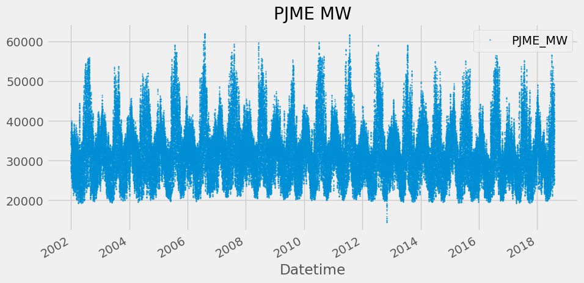
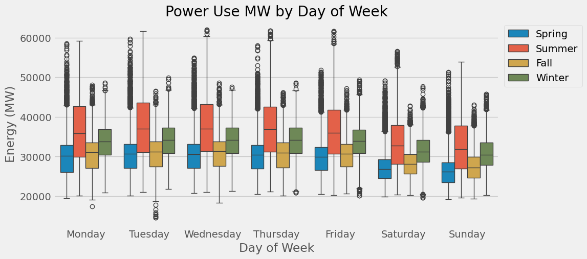
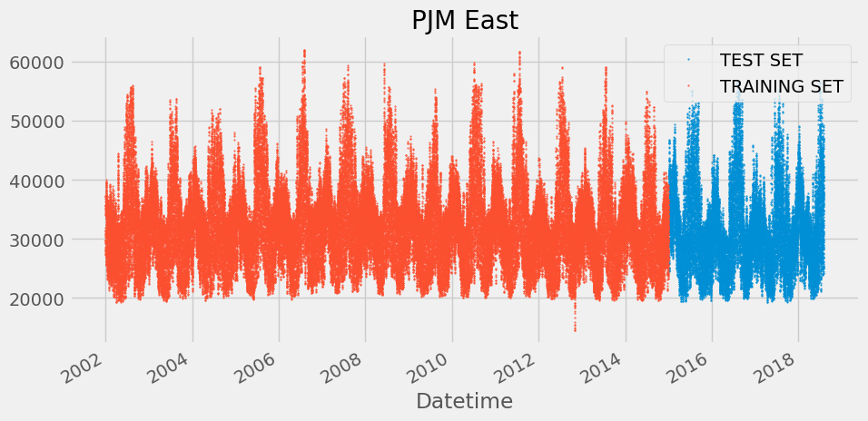
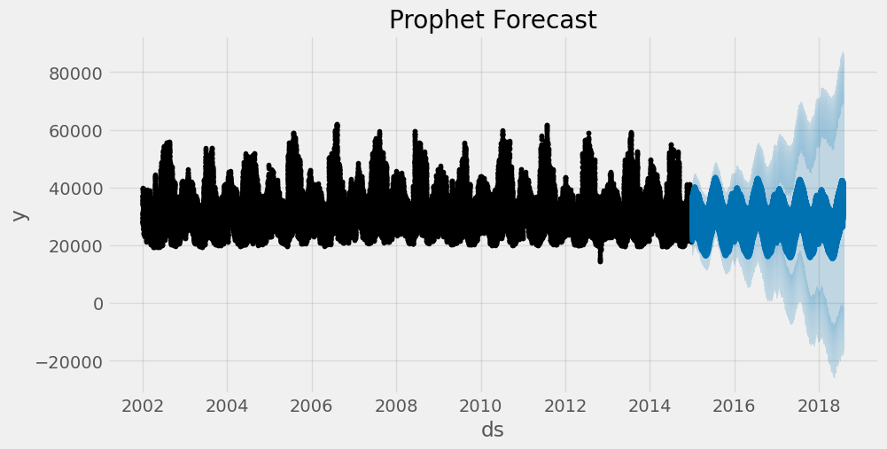
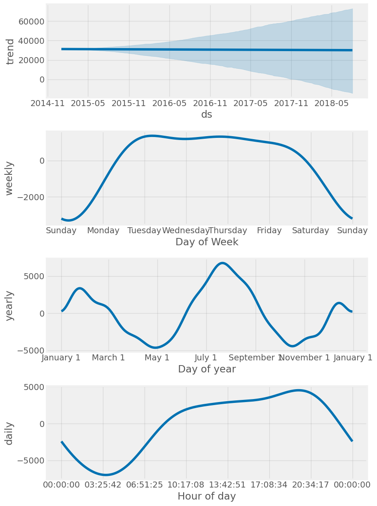
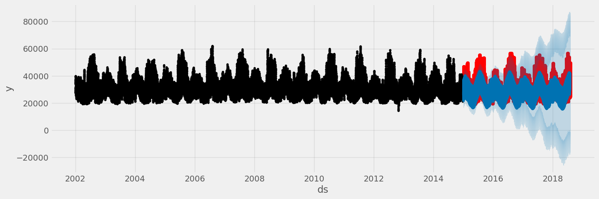
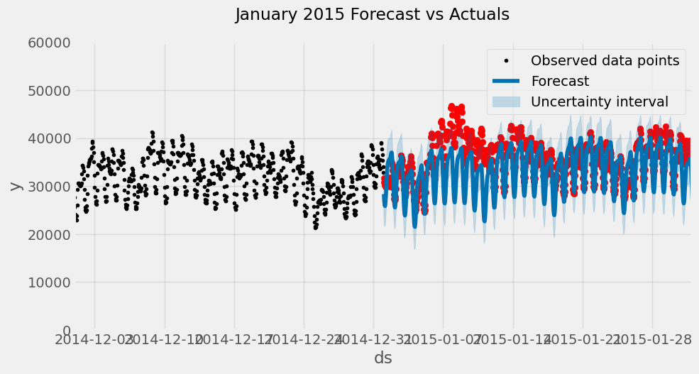
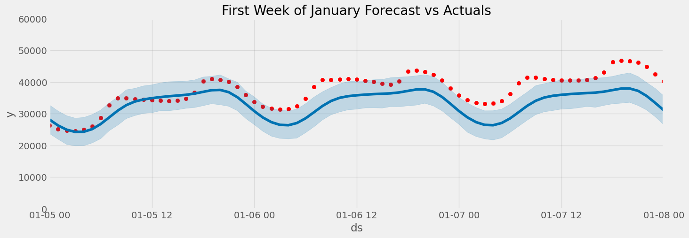
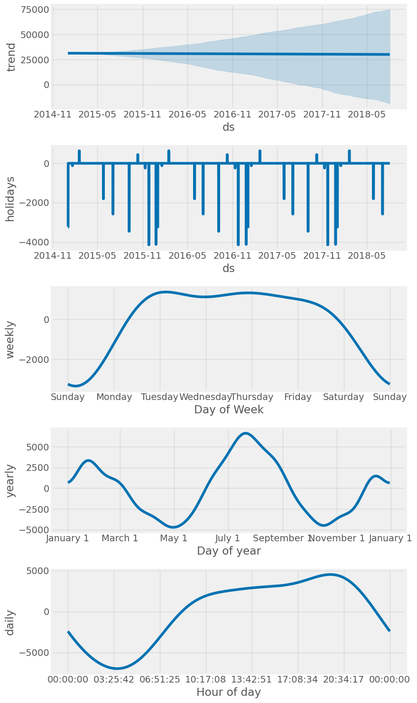
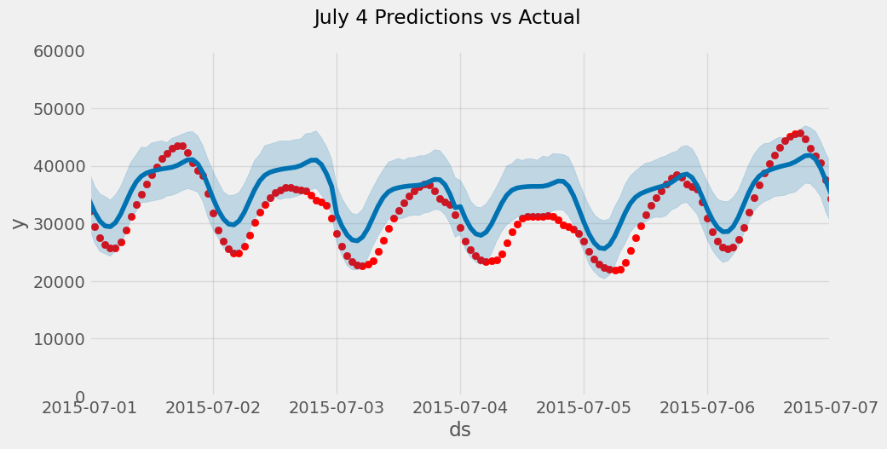

# Hourly Time Series Forecasting using Facebook’s Prophet

[In this notebook we will use facebook’s prophet package to forecast hourly energy use.](https://www.youtube.com/watch?v=j0eioK5edqg)

Author

Benedict Thekkel

# Background on the Types of Time Series Data


img

``` python
import numpy as np
import pandas as pd
import seaborn as sns
import matplotlib.pyplot as plt

from prophet import Prophet

from sklearn.metrics import mean_squared_error, mean_absolute_error

from pathlib import Path

import warnings
warnings.filterwarnings("ignore")

plt.style.use('ggplot')
plt.style.use('fivethirtyeight')

def mean_absolute_percentage_error(y_true, y_pred): 
    """Calculates MAPE given y_true and y_pred"""
    y_true, y_pred = np.array(y_true), np.array(y_pred)
    return np.mean(np.abs((y_true - y_pred) / y_true)) * 100
```

# Data

The data we will be using is hourly power consumption data from PJM. Energy consumption has some unique characteristics. It will be interesting to see how prophet picks them up.

Pulling the `PJM East` which has data from 2002-2018 for the entire east region.

``` python
name = 'hourly-energy-consumption'
path = Path(f'Data/{name}')
pjme = pd.read_csv(f'{path}/PJME_hourly.csv',
                   index_col=[0],
                  parse_dates=[0])
pjme.head()
```

|                     | PJME_MW |
|---------------------|---------|
| Datetime            |         |
| 2002-12-31 01:00:00 | 26498.0 |
| 2002-12-31 02:00:00 | 25147.0 |
| 2002-12-31 03:00:00 | 24574.0 |
| 2002-12-31 04:00:00 | 24393.0 |
| 2002-12-31 05:00:00 | 24860.0 |

``` python
color_pal = sns.color_palette()
pjme.plot(style='.',
          figsize=(10, 5),
          ms=1,
          color=color_pal[0],
          title='PJME MW')
plt.show()
```



# Time Series Features

``` python
from pandas.api.types import CategoricalDtype

cat_type = CategoricalDtype(categories=['Monday','Tuesday',
                                        'Wednesday',
                                        'Thursday','Friday',
                                        'Saturday','Sunday'],
                            ordered=True)

def create_features(df, label=None):
    """
    Creates time series features from datetime index.
    """
    df = df.copy()
    df['date'] = df.index
    df['hour'] = df['date'].dt.hour
    df['dayofweek'] = df['date'].dt.dayofweek
    df['weekday'] = df['date'].dt.day_name()
    df['weekday'] = df['weekday'].astype(cat_type)
    df['quarter'] = df['date'].dt.quarter
    df['month'] = df['date'].dt.month
    df['year'] = df['date'].dt.year
    df['dayofyear'] = df['date'].dt.dayofyear
    df['dayofmonth'] = df['date'].dt.day
    df['weekofyear'] = df['date'].dt.isocalendar().week
    df['date_offset'] = (df.date.dt.month*100 + df.date.dt.day - 320)%1300

    df['season'] = pd.cut(df['date_offset'], [0, 300, 602, 900, 1300], 
                          labels=['Spring', 'Summer', 'Fall', 'Winter']
                   )
    X = df[['hour','dayofweek','quarter','month','year',
           'dayofyear','dayofmonth','weekofyear','weekday',
           'season']]
    if label:
        y = df[label]
        return X, y
    return X

X, y = create_features(pjme, label='PJME_MW')
features_and_target = pd.concat([X, y], axis=1)
```

``` python
fig, ax = plt.subplots(figsize=(10, 5))
sns.boxplot(data=features_and_target.dropna(),
            x='weekday',
            y='PJME_MW',
            hue='season',
            ax=ax,
            linewidth=1)
ax.set_title('Power Use MW by Day of Week')
ax.set_xlabel('Day of Week')
ax.set_ylabel('Energy (MW)')
ax.legend(bbox_to_anchor=(1, 1))
plt.show()
```



# Train / Test Split

``` python
split_date = '1-Jan-2015'
pjme_train = pjme.loc[pjme.index <= split_date].copy()
pjme_test = pjme.loc[pjme.index > split_date].copy()

# Plot train and test so you can see where we have split
pjme_test \
    .rename(columns={'PJME_MW': 'TEST SET'}) \
    .join(pjme_train.rename(columns={'PJME_MW': 'TRAINING SET'}),
          how='outer') \
    .plot(figsize=(10, 5), title='PJM East', style='.', ms=1)
plt.show()
```



# Simple Prophet Model

- Prophet model expects the dataset to be named a specific way. We will rename our dataframe columns before feeding it into the model.
  - Datetime column named: `ds`
  - target : `y`

``` python
# Format data for prophet model using ds and y
pjme_train_prophet = pjme_train.reset_index() \
    .rename(columns={'Datetime':'ds',
                     'PJME_MW':'y'})
```

``` python
model = Prophet()
model.fit(pjme_train_prophet)
```

    18:04:09 - cmdstanpy - INFO - Chain [1] start processing
    18:04:59 - cmdstanpy - INFO - Chain [1] done processing

    <prophet.forecaster.Prophet>

``` python
# Predict on test set with model
pjme_test_prophet = pjme_test.reset_index() \
    .rename(columns={'Datetime':'ds',
                     'PJME_MW':'y'})

pjme_test_fcst = model.predict(pjme_test_prophet)
```

``` python
pjme_test_fcst.head()
```

|  | ds | trend | yhat_lower | yhat_upper | trend_lower | trend_upper | additive_terms | additive_terms_lower | additive_terms_upper | daily | ... | weekly | weekly_lower | weekly_upper | yearly | yearly_lower | yearly_upper | multiplicative_terms | multiplicative_terms_lower | multiplicative_terms_upper | yhat |
|----|----|----|----|----|----|----|----|----|----|----|----|----|----|----|----|----|----|----|----|----|----|
| 0 | 2015-01-01 01:00:00 | 31210.530967 | 23912.189071 | 32701.384160 | 31210.530967 | 31210.530967 | -2893.742472 | -2893.742472 | -2893.742472 | -4430.272423 | ... | 1281.328732 | 1281.328732 | 1281.328732 | 255.201219 | 255.201219 | 255.201219 | 0.0 | 0.0 | 0.0 | 28316.788495 |
| 1 | 2015-01-01 02:00:00 | 31210.494154 | 22326.307825 | 31018.012373 | 31210.494154 | 31210.494154 | -4398.239425 | -4398.239425 | -4398.239425 | -5927.272577 | ... | 1272.574102 | 1272.574102 | 1272.574102 | 256.459050 | 256.459050 | 256.459050 | 0.0 | 0.0 | 0.0 | 26812.254729 |
| 2 | 2015-01-01 03:00:00 | 31210.457342 | 21462.567951 | 30599.849415 | 31210.457342 | 31210.457342 | -5269.974485 | -5269.974485 | -5269.974485 | -6790.346308 | ... | 1262.613389 | 1262.613389 | 1262.613389 | 257.758434 | 257.758434 | 257.758434 | 0.0 | 0.0 | 0.0 | 25940.482857 |
| 3 | 2015-01-01 04:00:00 | 31210.420529 | 21734.347259 | 30591.022280 | 31210.420529 | 31210.420529 | -5411.456410 | -5411.456410 | -5411.456410 | -6922.126021 | ... | 1251.570211 | 1251.570211 | 1251.570211 | 259.099400 | 259.099400 | 259.099400 | 0.0 | 0.0 | 0.0 | 25798.964119 |
| 4 | 2015-01-01 05:00:00 | 31210.383716 | 22005.992294 | 31027.473128 | 31210.383716 | 31210.383716 | -4737.018106 | -4737.018106 | -4737.018106 | -6237.080479 | ... | 1239.580401 | 1239.580401 | 1239.580401 | 260.481971 | 260.481971 | 260.481971 | 0.0 | 0.0 | 0.0 | 26473.365610 |

5 rows × 22 columns

``` python
fig, ax = plt.subplots(figsize=(10, 5))
fig = model.plot(pjme_test_fcst, ax=ax)
ax.set_title('Prophet Forecast')
plt.show()
```



``` python
fig = model.plot_components(pjme_test_fcst)
plt.show()
```



# Compare Forecast to Actuals

``` python
# Plot the forecast with the actuals
f, ax = plt.subplots(figsize=(15, 5))
ax.scatter(pjme_test.index, pjme_test['PJME_MW'], color='r')
fig = model.plot(pjme_test_fcst, ax=ax)
```



``` python
pjme_test['PJME_MW'].head()
```

    Datetime
    2015-12-31 01:00:00    24305.0
    2015-12-31 02:00:00    23156.0
    2015-12-31 03:00:00    22514.0
    2015-12-31 04:00:00    22330.0
    2015-12-31 05:00:00    22773.0
    Name: PJME_MW, dtype: float64

``` python
fig, ax = plt.subplots(figsize=(10, 5))
ax.scatter(pjme_test.index, pjme_test['PJME_MW'], color='r')

fig = model.plot(pjme_test_fcst, ax=ax)
ax.set_xbound(lower=pd.to_datetime('12-01-2014'),
              upper=pd.to_datetime('02-01-2015'))
ax.set_ylim(0, 60000)
ax.legend()
plot = plt.suptitle('January 2015 Forecast vs Actuals')
```



``` python
# Plot the forecast with the actuals
f, ax = plt.subplots(figsize=(15, 5))
ax.scatter(pjme_test.index, pjme_test['PJME_MW'], color='r')
fig = model.plot(pjme_test_fcst, ax=ax)
ax.set_xbound(lower= pd.to_datetime('2015-01-05'), upper=pd.to_datetime('2015-01-08'))
ax.set_ylim(0, 60000)
ax.set_title('First Week of January Forecast vs Actuals')
plt.show()
```



# Evaluate the model with Error Metrics

``` python
np.sqrt(mean_squared_error(y_true=pjme_test['PJME_MW'],
                   y_pred=pjme_test_fcst['yhat']))
```

    6616.966074225221

``` python
mean_absolute_error(y_true=pjme_test['PJME_MW'],
                   y_pred=pjme_test_fcst['yhat'])
```

    5181.911537928106

``` python
mean_absolute_percentage_error(y_true=pjme_test['PJME_MW'],
                   y_pred=pjme_test_fcst['yhat'])
```

    16.512003880182647

# Adding Holidays

Next we will see if adding holiday indicators will help the accuracy of the model. Prophet comes with a Holiday Effects parameter that can be provided to the model prior to training.

We will use the built in pandas USFederalHolidayCalendar to pull the list of holidays

``` python
from pandas.tseries.holiday import USFederalHolidayCalendar as calendar

cal = calendar()


holidays = cal.holidays(start=pjme.index.min(),
                        end=pjme.index.max(),
                        return_name=True)
holiday_df = pd.DataFrame(data=holidays,
                          columns=['holiday'])
holiday_df = holiday_df.reset_index().rename(columns={'index':'ds'})
```

``` python
model_with_holidays = Prophet(holidays=holiday_df)
model_with_holidays.fit(pjme_train_prophet)
```

    18:05:15 - cmdstanpy - INFO - Chain [1] start processing
    18:06:36 - cmdstanpy - INFO - Chain [1] done processing

    <prophet.forecaster.Prophet>

``` python
# Predict on training set with model
pjme_test_fcst_with_hols = \
    model_with_holidays.predict(df=pjme_test_prophet)
```

``` python
fig = model_with_holidays.plot_components(
    pjme_test_fcst_with_hols)
plt.show()
```



``` python
fig, ax = plt.subplots(figsize=(10, 5))
ax.scatter(pjme_test.index, pjme_test['PJME_MW'], color='r')
fig = model.plot(pjme_test_fcst_with_hols, ax=ax)
ax.set_xbound(lower=pd.to_datetime('07-01-2015'),
              upper=pd.to_datetime('07-07-2015'))
ax.set_ylim(0, 60000)
plot = plt.suptitle('July 4 Predictions vs Actual')
```



``` python
np.sqrt(mean_squared_error(y_true=pjme_test['PJME_MW'],
                   y_pred=pjme_test_fcst_with_hols['yhat']))
```

    6639.587205626055

``` python
mean_absolute_error(y_true=pjme_test['PJME_MW'],
                   y_pred=pjme_test_fcst_with_hols['yhat'])
```

    5201.46462763833

``` python
mean_absolute_percentage_error(y_true=pjme_test['PJME_MW'],
                   y_pred=pjme_test_fcst_with_hols['yhat'])
```

    16.558807523531467

# Predict into the Future

We can use the built in `make_future_dataframe` method to build our future dataframe and make predictions.

``` python
future = model.make_future_dataframe(periods=365*24, freq='h', include_history=False)
forecast = model_with_holidays.predict(future)
```

``` python
forecast[['ds','yhat']].head()
```

|     | ds                  | yhat         |
|-----|---------------------|--------------|
| 0   | 2015-01-01 01:00:00 | 25567.271675 |
| 1   | 2015-01-01 02:00:00 | 24065.351481 |
| 2   | 2015-01-01 03:00:00 | 23195.828972 |
| 3   | 2015-01-01 04:00:00 | 23056.212620 |
| 4   | 2015-01-01 05:00:00 | 23732.192245 |

## On this site’s backtest

The walkthrough above follows the original tutorial on a different dataset, and its cells do not run here. This section puts Prophet on the same [backtest](../02_Evaluation/backtesting.llms.md) as every other model: the household series, 30 day-ahead windows, refitted at each origin on the last eight weeks, with daily and weekly seasonality and French public holidays.

Prophet (Taylor and Letham, 2018) fits a curve: a piecewise-linear trend plus Fourier seasonalities plus holiday effects, estimated with Stan. It was built for business series with strong human seasonality and missing data, and it is easy to use. Published comparisons have often found it behind simple baselines on general forecasting benchmarks, so it needs testing like anything else.

------------------------------------------------------------------------

``` python
import logging
import warnings

import numpy as np
import pandas as pd
from dateutil.easter import easter
from prophet import Prophet

from ML_Timeseries.backtest import backtest, record, score
from ML_Timeseries.data import line_chart, load_household, show

# Prophet attaches its own INFO handler to cmdstanpy, so a level change is not enough.
logging.getLogger("cmdstanpy").disabled = True
warnings.filterwarnings("ignore")
```

``` python
hh = load_household()
y, FILLED = hh["kwh"], hh["filled"]
holiday_dates = []
for yr in range(2006, 2011):
    e = pd.Timestamp(easter(yr))
    holiday_dates += [pd.Timestamp(f"{yr}-{md}") for md in ("01-01", "05-01", "05-08", "07-14", "08-15", "11-01", "11-11", "12-25")]
    holiday_dates += [e + pd.Timedelta(days=k) for k in (1, 39, 50)]
HOLIDAYS = pd.DataFrame({"holiday": "public holiday", "ds": holiday_dates})


def prophet_forecaster(history, horizon):
    train = pd.DataFrame({"ds": history.index[-24 * 7 * 8:], "y": history.iloc[-24 * 7 * 8:].to_numpy()})
    m = Prophet(daily_seasonality=True, weekly_seasonality=True, yearly_seasonality=False, holidays=HOLIDAYS)
    m.fit(train)
    future = m.make_future_dataframe(periods=horizon, freq="h", include_history=False)
    return m.predict(future)["yhat"].to_numpy()


bt = backtest(y, prophet_forecaster)
prophet_score = score(bt, y, exclude=FILLED)
_ = record("Prophet (daily + weekly + holidays)", "classical", prophet_score, notebook="03_Classical/08_Prophet")
print(f"Prophet: MASE {prophet_score['mase']:.3f}, skill {prophet_score['skill']:+.1%}, {prophet_score['seconds']:.0f} s for 30 fits")
```

    Prophet: MASE 0.766, skill +3.9%, 3 s for 30 fits

``` python
w = bt.window.max()
last = bt[bt.window == w]
show(line_chart(last.ds.dt.strftime("%a %H:00"), {"actual": last.y, "Prophet": last.yhat}, y_name="kWh", height="320px", zoom=False))
```

Prophet lands level with the free forecasts on the [Baselines](../03_Classical/baselines.llms.md) page: about the same skill as the median of the same hour over the last four weeks, and far behind [SARIMA](../03_Classical/arima.llms.md), tuned [Holt-Winters](../03_Classical/ets.llms.md) and gradient boosting. That is roughly what its design predicts. With a flat trend over eight weeks, Prophet’s forecast is a smooth daily-plus-weekly Fourier profile fitted to those weeks, which is a smoothed seasonal average. It has no short-term memory: unlike SARIMA’s AR terms, nothing in it says “today is running high, so tonight will too”.

Prophet earns its place elsewhere: long daily or weekly business series with several seasonalities, holidays, missing data and changepoints in the trend, where an analyst wants interpretable components and tunable knobs more than the last few percent of accuracy.

------------------------------------------------------------------------

Back to top
