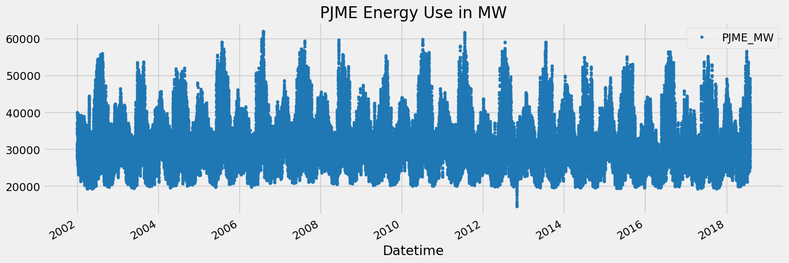
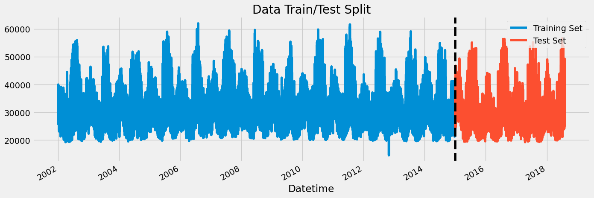
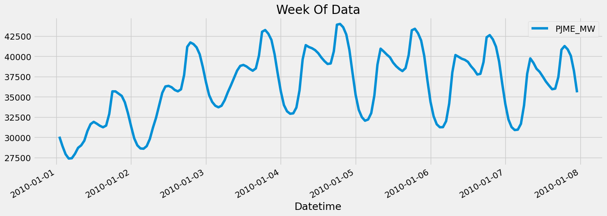
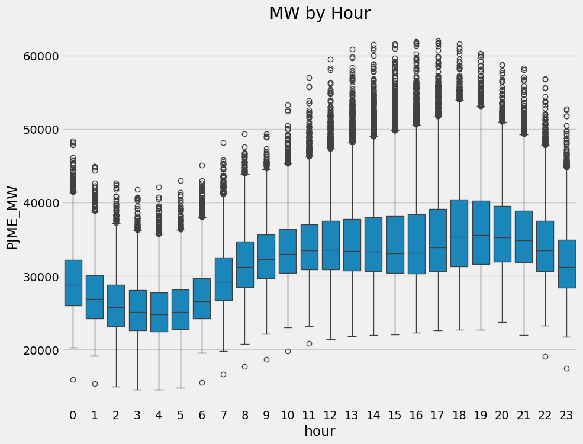
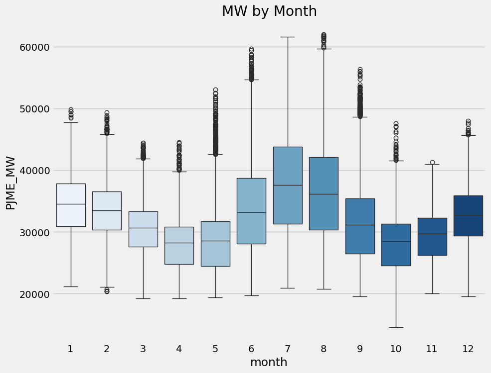
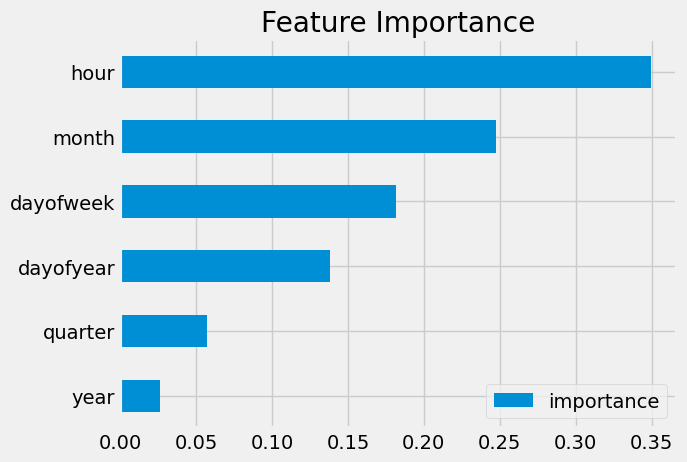
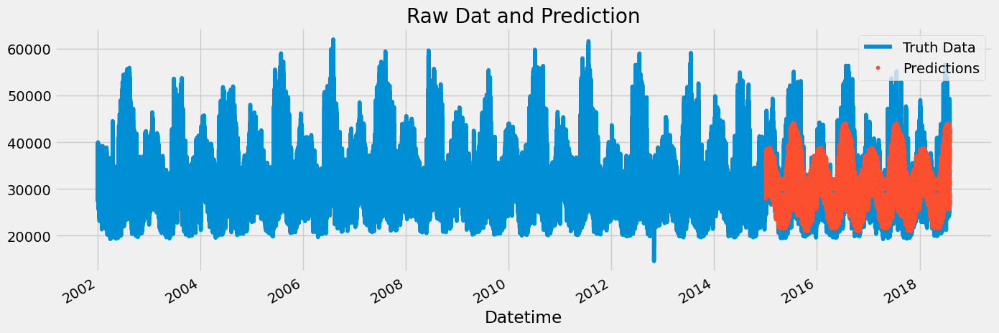
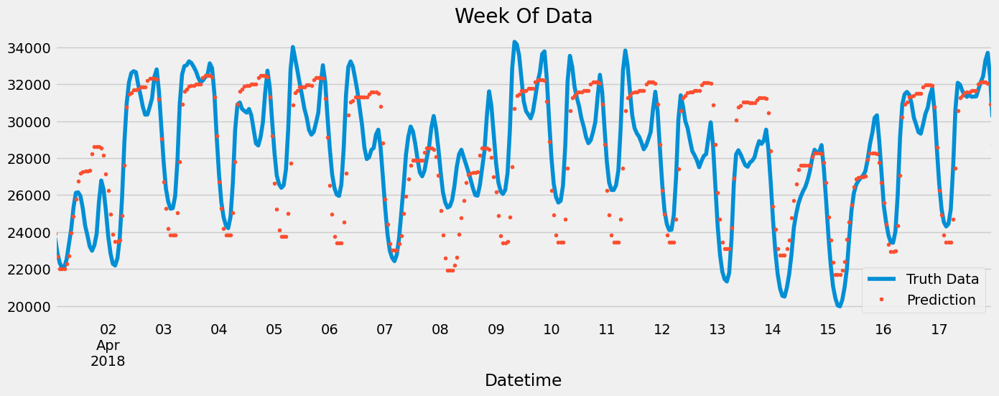

# XGBoost

[XGBoost](https://www.youtube.com/watch?v=vV12dGe_Fho&t=226s)

Author

Benedict Thekkel

``` python
import pandas as pd
import numpy as np
import matplotlib.pyplot as plt
import seaborn as sns
from fastai.imports import *
import xgboost as xgb
from sklearn.metrics import mean_squared_error
import zipfile,kaggle
import os
```

``` python
color_pal = sns.color_palette()
plt.style.use('fivethirtyeight')
```

``` python
from nbdevAuto.functions import * 
import nbdevAuto.functions
```

``` python
name = 'hourly-energy-consumption'
path = Path(f'Data/{name}')
user = 'robikscube'
kaggle_dataset_download(user = user, 
                         name = name)
```

``` python
df = pd.read_csv(f'{path}/PJME_hourly.csv')
df = df.set_index('Datetime')
df.index = pd.to_datetime(df.index)
```

``` python
df.plot(style='.',
        figsize=(15, 5),
        color=color_pal[0],
        title='PJME Energy Use in MW')
plt.show()
```



# Train / Test Split

``` python
train = df.loc[df.index < '01-01-2015']
test = df.loc[df.index >= '01-01-2015']

fig, ax = plt.subplots(figsize=(15, 5))
train.plot(ax=ax, label='Training Set', title='Data Train/Test Split')
test.plot(ax=ax, label='Test Set')
ax.axvline('01-01-2015', color='black', ls='--')
ax.legend(['Training Set', 'Test Set'])
plt.show()
```



``` python
df.loc[(df.index > '01-01-2010') & (df.index < '01-08-2010')] \
    .plot(figsize=(15, 5), title='Week Of Data')
plt.show()
```



# Feature Creation

``` python
def create_features(df):
    """
    Create time series features based on time series index.
    """
    df = df.copy()
    df['hour'] = df.index.hour
    df['dayofweek'] = df.index.dayofweek
    df['quarter'] = df.index.quarter
    df['month'] = df.index.month
    df['year'] = df.index.year
    df['dayofyear'] = df.index.dayofyear
    df['dayofmonth'] = df.index.day
    df['weekofyear'] = df.index.isocalendar().week
    return df

df = create_features(df)
```

# Visualize our Feature / Target Relationship

``` python
fig, ax = plt.subplots(figsize=(10, 8))
sns.boxplot(data=df, x='hour', y='PJME_MW')
ax.set_title('MW by Hour')
plt.show()
```



``` python
fig, ax = plt.subplots(figsize=(10, 8))
sns.boxplot(data=df, x='month', y='PJME_MW', palette='Blues')
ax.set_title('MW by Month')
plt.show()
```

    /tmp/ipykernel_109462/958582662.py:3: FutureWarning: 

    Passing `palette` without assigning `hue` is deprecated and will be removed in v0.14.0. Assign the `x` variable to `hue` and set `legend=False` for the same effect.

      sns.boxplot(data=df, x='month', y='PJME_MW', palette='Blues')



# Create our Model

``` python
train = create_features(train)
test = create_features(test)

FEATURES = ['dayofyear', 'hour', 'dayofweek', 'quarter', 'month', 'year']
TARGET = 'PJME_MW'

X_train = train[FEATURES]
y_train = train[TARGET]

X_test = test[FEATURES]
y_test = test[TARGET]
```

``` python
reg = xgb.XGBRegressor(base_score=0.5, booster='gbtree',    
                       n_estimators=1000,
                       early_stopping_rounds=50,
                       objective='reg:linear',
                       max_depth=3,
                       learning_rate=0.01)
reg.fit(X_train, y_train,
        eval_set=[(X_train, y_train), (X_test, y_test)],
        verbose=100)
```

    [0] validation_0-rmse:32605.13970   validation_1-rmse:31657.15729

    /home/thekkel/mambaforge/envs/cfast/lib/python3.11/site-packages/xgboost/core.py:160: UserWarning: [17:58:09] WARNING: /workspace/src/objective/regression_obj.cu:209: reg:linear is now deprecated in favor of reg:squarederror.
      warnings.warn(smsg, UserWarning)

    [100]   validation_0-rmse:12584.35462   validation_1-rmse:11747.28803
    [200]   validation_0-rmse:5837.33066    validation_1-rmse:5363.58554
    [300]   validation_0-rmse:3923.28511    validation_1-rmse:4020.48045
    [400]   validation_0-rmse:3447.54638    validation_1-rmse:3860.60088
    [500]   validation_0-rmse:3288.19208    validation_1-rmse:3816.37862
    [600]   validation_0-rmse:3206.55619    validation_1-rmse:3779.04119
    [700]   validation_0-rmse:3153.61368    validation_1-rmse:3754.45684
    [800]   validation_0-rmse:3114.34038    validation_1-rmse:3738.38209
    [900]   validation_0-rmse:3084.39550    validation_1-rmse:3730.01893
    [989]   validation_0-rmse:3059.85847    validation_1-rmse:3727.94591

    XGBRegressor(base_score=0.5, booster='gbtree', callbacks=None,
                 colsample_bylevel=None, colsample_bynode=None,
                 colsample_bytree=None, device=None, early_stopping_rounds=50,
                 enable_categorical=False, eval_metric=None, feature_types=None,
                 gamma=None, grow_policy=None, importance_type=None,
                 interaction_constraints=None, learning_rate=0.01, max_bin=None,
                 max_cat_threshold=None, max_cat_to_onehot=None,
                 max_delta_step=None, max_depth=3, max_leaves=None,
                 min_child_weight=None, missing=nan, monotone_constraints=None,
                 multi_strategy=None, n_estimators=1000, n_jobs=None,
                 num_parallel_tree=None, objective='reg:linear', ...)

**In a Jupyter environment, please rerun this cell to show the HTML representation or trust the notebook.\
On GitHub, the HTML representation is unable to render, please try loading this page with nbviewer.org.**

XGBRegressor

    XGBRegressor(base_score=0.5, booster='gbtree', callbacks=None,
                 colsample_bylevel=None, colsample_bynode=None,
                 colsample_bytree=None, device=None, early_stopping_rounds=50,
                 enable_categorical=False, eval_metric=None, feature_types=None,
                 gamma=None, grow_policy=None, importance_type=None,
                 interaction_constraints=None, learning_rate=0.01, max_bin=None,
                 max_cat_threshold=None, max_cat_to_onehot=None,
                 max_delta_step=None, max_depth=3, max_leaves=None,
                 min_child_weight=None, missing=nan, monotone_constraints=None,
                 multi_strategy=None, n_estimators=1000, n_jobs=None,
                 num_parallel_tree=None, objective='reg:linear', ...)

# Feature Importance

``` python
fi = pd.DataFrame(data=reg.feature_importances_,
             index=reg.feature_names_in_,
             columns=['importance'])
fi.sort_values('importance').plot(kind='barh', title='Feature Importance')
plt.show()
```



# Forecast on Test

``` python
test['prediction'] = reg.predict(X_test)
df = df.merge(test[['prediction']], how='left', left_index=True, right_index=True)
ax = df[['PJME_MW']].plot(figsize=(15, 5))
df['prediction'].plot(ax=ax, style='.')
plt.legend(['Truth Data', 'Predictions'])
ax.set_title('Raw Dat and Prediction')
plt.show()
```



``` python
ax = df.loc[(df.index > '04-01-2018') & (df.index < '04-18-2018')]['PJME_MW'] \
    .plot(figsize=(15, 5), title='Week Of Data')
df.loc[(df.index > '04-01-2018') & (df.index < '04-18-2018')]['prediction'] \
    .plot(style='.')
plt.legend(['Truth Data','Prediction'])
plt.show()
```



# Score (RMSE)

``` python
score = np.sqrt(mean_squared_error(test['PJME_MW'], test['prediction']))
print(f'RMSE Score on Test set: {score:0.2f}')
```

    RMSE Score on Test set: 3726.80

# Calculate Error

- Look at the worst and best predicted days

``` python
test['error'] = np.abs(test[TARGET] - test['prediction'])
test['date'] = test.index.date
test.groupby(['date'])['error'].mean().sort_values(ascending=False).head(10)
```

    date
    2016-08-13    12879.484619
    2016-08-14    12772.887207
    2015-02-20    11186.031494
    2016-09-09    10966.513102
    2016-09-10    10889.102214
    2018-01-06    10642.975830
    2016-08-12    10041.172689
    2015-02-21     9988.168783
    2015-02-16     9900.809326
    2018-01-07     9852.571370
    Name: error, dtype: float64

# Next Steps

- More robust cross validation
- Add more features (weather forecast, holidays)

Back to top
