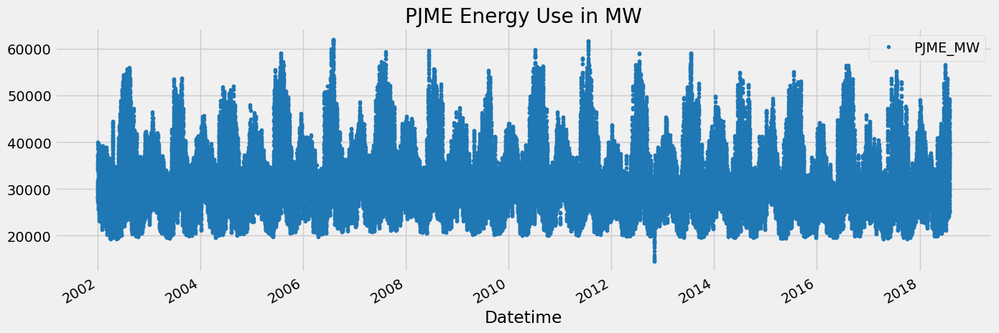
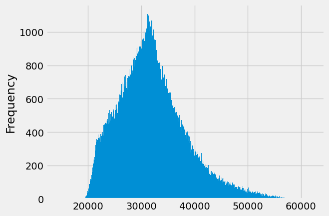
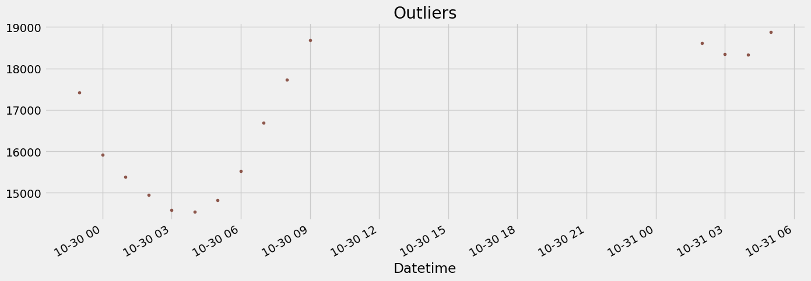
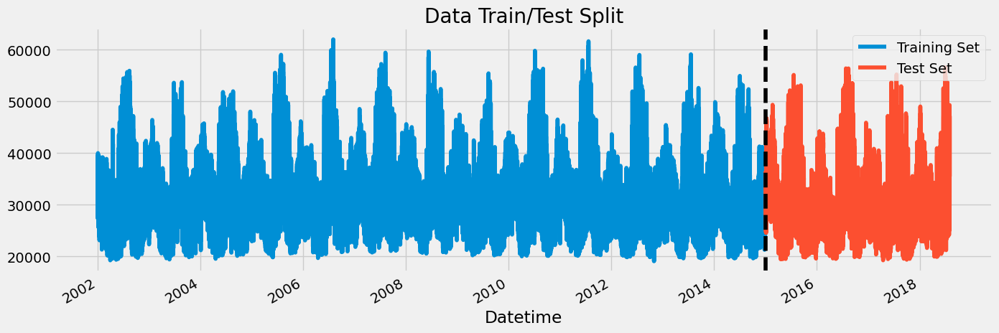
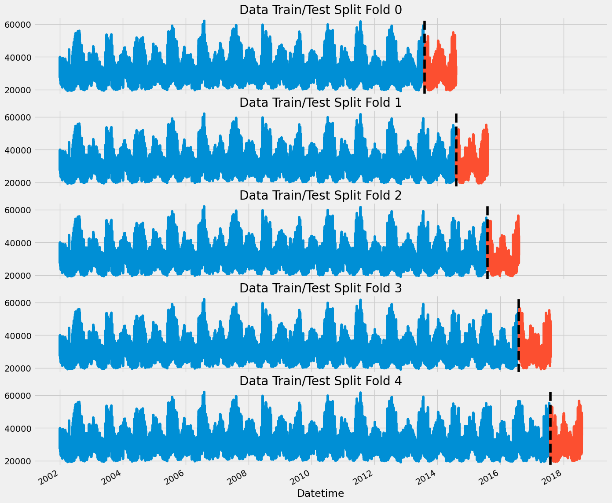
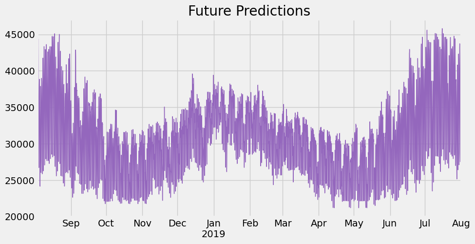

# XGBoost: Forecast Energy Consumption

[Using Machine Learning to Forecast Energy Consumption](https://www.youtube.com/watch?v=z3ZnOW-S550)

Author

Benedict Thekkel

``` python
import pandas as pd
import numpy as np
import matplotlib.pyplot as plt
import seaborn as sns

import os
import zipfile,kaggle
from fastai.imports import *

import xgboost as xgb
from sklearn.metrics import mean_squared_error

from nbdevAuto.functions import * 
import nbdevAuto.functions
```

``` python
color_pal = sns.color_palette()
plt.style.use('fivethirtyeight')

name = 'hourly-energy-consumption'
path = Path(f'Data/{name}')
user = 'robikscube'
kaggle_dataset_download(user = user, 
                         name = name)
```

    file exists

``` python
df = pd.read_csv(f'{path}/PJME_hourly.csv')
df = df.set_index('Datetime')
df.index = pd.to_datetime(df.index)
```

``` python
df.plot(style='.',
        figsize=(15, 5),
        color=color_pal[0],
        title='PJME Energy Use in MW')
plt.show()
```



# 1. Outlier Analysis and removal

``` python
df['PJME_MW'].plot(kind='hist', bins=500)
```



``` python
df.query('PJME_MW < 19_000')['PJME_MW'] \
    .plot(style='.',
          figsize=(15, 5),
          color=color_pal[5],
          title='Outliers')
```



``` python
df = df.query('PJME_MW > 19_000').copy()
```

# Reviewing: Train / Test Split

``` python
train = df.loc[df.index < '01-01-2015']
test = df.loc[df.index >= '01-01-2015']

fig, ax = plt.subplots(figsize=(15, 5))
train.plot(ax=ax, label='Training Set', title='Data Train/Test Split')
test.plot(ax=ax, label='Test Set')
ax.axvline('01-01-2015', color='black', ls='--')
ax.legend(['Training Set', 'Test Set'])
plt.show()
```



# 1. Time Series Cross Validation

``` python
from sklearn.model_selection import TimeSeriesSplit

tss = TimeSeriesSplit(n_splits=5, test_size=24*365*1, gap=24)
df = df.sort_index()
```

``` python
fig, axs = plt.subplots(5, 1, figsize=(15, 15), sharex=True)

fold = 0
for train_idx, val_idx in tss.split(df):
    train = df.iloc[train_idx]
    test = df.iloc[val_idx]
    train['PJME_MW'].plot(ax=axs[fold],
                          label='Training Set',
                          title=f'Data Train/Test Split Fold {fold}')
    test['PJME_MW'].plot(ax=axs[fold],
                         label='Test Set')
    axs[fold].axvline(test.index.min(), color='black', ls='--')
    fold += 1
plt.show()
```



# 2. Forecasting Horizon Explained

**The forecast horizon is the length of time into the future for which forecasts are to be prepared. These generally vary from short-term forecasting horizons (less than three months) to long-term horizons (more than two years).**

``` python
def create_features(df):
    """
    Create time series features based on time series index.
    """
    df = df.copy()
    df['hour'] = df.index.hour
    df['dayofweek'] = df.index.dayofweek
    df['quarter'] = df.index.quarter
    df['month'] = df.index.month
    df['year'] = df.index.year
    df['dayofyear'] = df.index.dayofyear
    df['dayofmonth'] = df.index.day
    df['weekofyear'] = df.index.isocalendar().week
    return df

df = create_features(df)
```

# 3. Lag Features

- What was the target (x) days in the past.

``` python
def add_lags(df):
    target_map = df['PJME_MW'].to_dict()
    df['lag1'] = (df.index - pd.Timedelta('364 days')).map(target_map)
    df['lag2'] = (df.index - pd.Timedelta('728 days')).map(target_map)
    df['lag3'] = (df.index - pd.Timedelta('1092 days')).map(target_map)
    return df
```

``` python
df = add_lags(df)
```

## Train Using Cross Validation

``` python
tss = TimeSeriesSplit(n_splits=5, test_size=24*365*1, gap=24)
df = df.sort_index()


fold = 0
preds = []
scores = []
for train_idx, val_idx in tss.split(df):
    train = df.iloc[train_idx]
    test = df.iloc[val_idx]

    train = create_features(train)
    test = create_features(test)

    FEATURES = ['dayofyear', 'hour', 'dayofweek', 'quarter', 'month','year',
                'lag1','lag2','lag3']
    TARGET = 'PJME_MW'

    X_train = train[FEATURES]
    y_train = train[TARGET]

    X_test = test[FEATURES]
    y_test = test[TARGET]

    reg = xgb.XGBRegressor(base_score=0.5, booster='gbtree',    
                           n_estimators=1000,
                           early_stopping_rounds=50,
                           objective='reg:linear',
                           max_depth=3,
                           learning_rate=0.01)
    reg.fit(X_train, y_train,
            eval_set=[(X_train, y_train), (X_test, y_test)],
            verbose=100)

    y_pred = reg.predict(X_test)
    preds.append(y_pred)
    score = np.sqrt(mean_squared_error(y_test, y_pred))
    scores.append(score)
```

    [0] validation_0-rmse:32732.49608   validation_1-rmse:31956.60163

    /home/thekkel/mambaforge/envs/cfast/lib/python3.11/site-packages/xgboost/core.py:160: UserWarning: [17:58:44] WARNING: /workspace/src/objective/regression_obj.cu:209: reg:linear is now deprecated in favor of reg:squarederror.
      warnings.warn(smsg, UserWarning)

    [100]   validation_0-rmse:12532.64369   validation_1-rmse:11906.14134
    [200]   validation_0-rmse:5747.92495    validation_1-rmse:5359.26490
    [300]   validation_0-rmse:3872.48134    validation_1-rmse:3900.86965
    [400]   validation_0-rmse:3434.23853    validation_1-rmse:3762.33705
    [442]   validation_0-rmse:3369.34730    validation_1-rmse:3764.82810
    [0] validation_0-rmse:32672.16678   validation_1-rmse:32138.89241

    /home/thekkel/mambaforge/envs/cfast/lib/python3.11/site-packages/xgboost/core.py:160: UserWarning: [17:58:47] WARNING: /workspace/src/objective/regression_obj.cu:209: reg:linear is now deprecated in favor of reg:squarederror.
      warnings.warn(smsg, UserWarning)

    [100]   validation_0-rmse:12513.65574   validation_1-rmse:12224.93373
    [200]   validation_0-rmse:5753.34937    validation_1-rmse:5662.07107
    [300]   validation_0-rmse:3902.71304    validation_1-rmse:3933.73076
    [400]   validation_0-rmse:3476.90515    validation_1-rmse:3590.55005
    [500]   validation_0-rmse:3353.72424    validation_1-rmse:3516.39915
    [600]   validation_0-rmse:3297.94766    validation_1-rmse:3481.94003
    [700]   validation_0-rmse:3258.48267    validation_1-rmse:3461.37383
    [800]   validation_0-rmse:3221.51553    validation_1-rmse:3436.49603
    [900]   validation_0-rmse:3190.11480    validation_1-rmse:3428.88699
    [999]   validation_0-rmse:3166.16314    validation_1-rmse:3420.31309
    [0] validation_0-rmse:32631.20370   validation_1-rmse:31073.29733

    /home/thekkel/mambaforge/envs/cfast/lib/python3.11/site-packages/xgboost/core.py:160: UserWarning: [17:58:52] WARNING: /workspace/src/objective/regression_obj.cu:209: reg:linear is now deprecated in favor of reg:squarederror.
      warnings.warn(smsg, UserWarning)

    [100]   validation_0-rmse:12499.28425   validation_1-rmse:11136.70202
    [200]   validation_0-rmse:5750.81453    validation_1-rmse:4813.22087
    [300]   validation_0-rmse:3917.04200    validation_1-rmse:3553.46419
    [400]   validation_0-rmse:3494.55924    validation_1-rmse:3495.32356
    [410]   validation_0-rmse:3476.66883    validation_1-rmse:3502.25535
    [0] validation_0-rmse:32528.44438   validation_1-rmse:31475.39670

    /home/thekkel/mambaforge/envs/cfast/lib/python3.11/site-packages/xgboost/core.py:160: UserWarning: [17:58:55] WARNING: /workspace/src/objective/regression_obj.cu:209: reg:linear is now deprecated in favor of reg:squarederror.
      warnings.warn(smsg, UserWarning)

    [100]   validation_0-rmse:12462.36581   validation_1-rmse:12020.28283
    [200]   validation_0-rmse:5738.57925    validation_1-rmse:5796.45874
    [300]   validation_0-rmse:3918.53218    validation_1-rmse:4388.39477
    [400]   validation_0-rmse:3501.24270    validation_1-rmse:4173.36380
    [500]   validation_0-rmse:3384.02490    validation_1-rmse:4119.56538
    [600]   validation_0-rmse:3325.50024    validation_1-rmse:4105.01446
    [700]   validation_0-rmse:3282.73755    validation_1-rmse:4091.23557
    [800]   validation_0-rmse:3250.37610    validation_1-rmse:4083.12690
    [900]   validation_0-rmse:3223.87814    validation_1-rmse:4081.46154
    [999]   validation_0-rmse:3199.82843    validation_1-rmse:4052.57120
    [0] validation_0-rmse:32462.05557   validation_1-rmse:31463.90500

    /home/thekkel/mambaforge/envs/cfast/lib/python3.11/site-packages/xgboost/core.py:160: UserWarning: [17:59:02] WARNING: /workspace/src/objective/regression_obj.cu:209: reg:linear is now deprecated in favor of reg:squarederror.
      warnings.warn(smsg, UserWarning)

    [100]   validation_0-rmse:12445.87740   validation_1-rmse:11963.42706
    [200]   validation_0-rmse:5752.44568    validation_1-rmse:5611.92884
    [300]   validation_0-rmse:3951.51709    validation_1-rmse:4156.41403
    [400]   validation_0-rmse:3539.25569    validation_1-rmse:4006.58873
    [440]   validation_0-rmse:3479.88018    validation_1-rmse:4011.05271

``` python
print(f'Score across folds {np.mean(scores):0.4f}')
print(f'Fold scores:{scores}')
```

    Score across folds 3742.5833
    Fold scores:[3760.8277187583353, 3420.313091887879, 3478.018038580526, 4052.5712055405547, 4001.186553933809]

# 4. Predicting the Future

- Retraining on all data
- To Predict the future we need an emtpy dataframe for future date ranges.
- Run those dates through our feature creation code + lag creation

``` python
# Retrain on all data
df = create_features(df)

FEATURES = ['dayofyear', 'hour', 'dayofweek', 'quarter', 'month', 'year',
            'lag1','lag2','lag3']
TARGET = 'PJME_MW'

X_all = df[FEATURES]
y_all = df[TARGET]

reg = xgb.XGBRegressor(base_score=0.5,
                       booster='gbtree',    
                       n_estimators=500,
                       objective='reg:linear',
                       max_depth=3,
                       learning_rate=0.01)
reg.fit(X_all, y_all,
        eval_set=[(X_all, y_all)],
        verbose=100)
```

    [0] validation_0-rmse:32403.88991

    /home/thekkel/mambaforge/envs/cfast/lib/python3.11/site-packages/xgboost/core.py:160: UserWarning: [17:59:05] WARNING: /workspace/src/objective/regression_obj.cu:209: reg:linear is now deprecated in favor of reg:squarederror.
      warnings.warn(smsg, UserWarning)

    [100]   validation_0-rmse:12426.83220
    [200]   validation_0-rmse:5751.73275
    [300]   validation_0-rmse:3971.53256
    [400]   validation_0-rmse:3571.21833
    [499]   validation_0-rmse:3456.76877

    XGBRegressor(base_score=0.5, booster='gbtree', callbacks=None,
                 colsample_bylevel=None, colsample_bynode=None,
                 colsample_bytree=None, device=None, early_stopping_rounds=None,
                 enable_categorical=False, eval_metric=None, feature_types=None,
                 gamma=None, grow_policy=None, importance_type=None,
                 interaction_constraints=None, learning_rate=0.01, max_bin=None,
                 max_cat_threshold=None, max_cat_to_onehot=None,
                 max_delta_step=None, max_depth=3, max_leaves=None,
                 min_child_weight=None, missing=nan, monotone_constraints=None,
                 multi_strategy=None, n_estimators=500, n_jobs=None,
                 num_parallel_tree=None, objective='reg:linear', ...)

**In a Jupyter environment, please rerun this cell to show the HTML representation or trust the notebook.\
On GitHub, the HTML representation is unable to render, please try loading this page with nbviewer.org.**

XGBRegressor

    XGBRegressor(base_score=0.5, booster='gbtree', callbacks=None,
                 colsample_bylevel=None, colsample_bynode=None,
                 colsample_bytree=None, device=None, early_stopping_rounds=None,
                 enable_categorical=False, eval_metric=None, feature_types=None,
                 gamma=None, grow_policy=None, importance_type=None,
                 interaction_constraints=None, learning_rate=0.01, max_bin=None,
                 max_cat_threshold=None, max_cat_to_onehot=None,
                 max_delta_step=None, max_depth=3, max_leaves=None,
                 min_child_weight=None, missing=nan, monotone_constraints=None,
                 multi_strategy=None, n_estimators=500, n_jobs=None,
                 num_parallel_tree=None, objective='reg:linear', ...)

``` python
df.index.max()
```

    Timestamp('2018-08-03 00:00:00')

``` python
# Create future dataframe
future = pd.date_range('2018-08-03','2019-08-01', freq='1h')
future_df = pd.DataFrame(index=future)
future_df['isFuture'] = True
df['isFuture'] = False
df_and_future = pd.concat([df, future_df])
df_and_future = create_features(df_and_future)
df_and_future = add_lags(df_and_future)
```

``` python
future_w_features = df_and_future.query('isFuture').copy()
```

## Predict the future

``` python
future_w_features['pred'] = reg.predict(future_w_features[FEATURES])
```

``` python
future_w_features['pred'].plot(figsize=(10, 5),
                               color=color_pal[4],
                               ms=1,
                               lw=1,
                               title='Future Predictions')
plt.show()
```


# Bonus: Saving Model For later

``` python
# Save model
reg.save_model('model.json')
```

``` python
reg_new = xgb.XGBRegressor()
reg_new.load_model('model.json')
future_w_features['pred'] = reg_new.predict(future_w_features[FEATURES])
future_w_features['pred'].plot(figsize=(10, 5),
                               color=color_pal[4],
                               ms=1, lw=1,
                               title='Future Predictions')
```



# On this site’s backtest

The tutorial above uses the PJM East dataset and its cells do not run here. This section runs XGBoost on the household series with the [backtest](../02_Evaluation/backtesting.llms.md) every other model uses, and with the feature set that scored best on the [Feature Engineering](../01_Foundations/feature_engineering.llms.md) page (seasonal lags, calendar, Fourier terms and rolling statistics, all known 24 hours ahead), imported from `ML_Timeseries.features`. The model trains once on everything before the first test origin.

------------------------------------------------------------------------

``` python
import numpy as np
import pandas as pd
import xgboost as xgb

from ML_Timeseries.backtest import backtest, future_index, origins, record, score
from ML_Timeseries.data import load_household
from ML_Timeseries.features import make_features
```

``` python
hh = load_household()
y, FILLED = hh["kwh"], hh["filled"]
train = y.iloc[:origins(y.index)[0]]
model = xgb.XGBRegressor(n_estimators=600, learning_rate=0.03, max_depth=6, subsample=0.8, colsample_bytree=0.8,
                         tree_method="hist", n_jobs=1, random_state=0)
model.fit(make_features(train).iloc[700:], train.iloc[700:])


def xgb_forecaster(history, horizon):
    ext = pd.concat([history.iloc[-800:], pd.Series(np.nan, index=future_index(history, horizon))])
    return model.predict(make_features(ext).iloc[-horizon:])


xgb_score = score(backtest(y, xgb_forecaster), y, exclude=FILLED)
_ = record("XGBoost, engineered features", "machine learning", xgb_score, notebook="04_Machine_Learning/05_XGBoost_Energy")
print(f"XGBoost: MASE {xgb_score['mase']:.3f}, skill {xgb_score['skill']:+.1%}")
```

    XGBoost: MASE 0.663, skill +17.5%

XGBoost lands within half a point of scikit-learn’s histogram gradient boosting on the same features (both about +17% skill against seasonal naive). The two libraries implement the same idea, boosted regression trees on binned features, and on a table of a few dozen columns their differences in regularisation and tree growth barely register. The [Feature Engineering](../01_Foundations/feature_engineering.llms.md) ablation showed where the gains come from: the features, and above all the calendar. Choose between XGBoost, LightGBM and scikit-learn on speed, deployment and API, not on expected accuracy.

------------------------------------------------------------------------

# The End

Back to top
