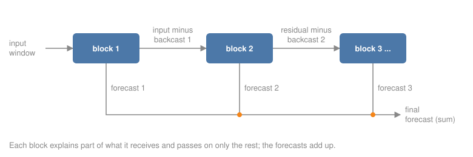

# N-BEATS from Scratch

The N-BEATS architecture in about 60 lines of PyTorch: blocks that forecast and subtract, stacked so each block models what the previous ones missed. Trained on the household data and compared with the library version.

Author

Benedict Thekkel

## Why build one

The library models on the previous pages hide their machinery behind `fit`. N-BEATS (Oreshkin et al., 2020) is small enough to write out in full, and writing it shows the one idea that makes it work: **doubly residual stacking**.

Each **block** takes an input window and produces two things:

- a **forecast** of the next 24 hours;
- a **backcast**: its own reconstruction of the input window.

The next block receives the input *minus* the backcast, the part the first block could not explain. The final forecast is the *sum* of all blocks’ forecasts. Early blocks pick up the dominant pattern (the daily shape), later blocks refine what is left. It is boosting, built into one differentiable network and trained end to end.

 GPU page, so `skip_exec` with stored outputs.

------------------------------------------------------------------------

``` python
import gc
import time

import numpy as np
import pandas as pd
import torch
from torch import nn

from ML_Timeseries.backtest import backtest, load_results, origins, record, score
from ML_Timeseries.data import line_chart, load_household, show

DEVICE = "cuda" if torch.cuda.is_available() else "cpu"
```

``` python
hh = load_household()
y, FILLED = hh["kwh"], hh["filled"]
NB = "05_Deep_Learning/05_NBEATS_From_Scratch"
L, H = 168, 24
train_values = torch.tensor(y.iloc[:origins(y.index)[0]].to_numpy(dtype=np.float32))
X = train_values[:-H].unfold(0, L, 1)
T = train_values[L:].unfold(0, H, 1)
n = min(len(X), len(T))
X, T = X[:n].to(DEVICE), T[:n].to(DEVICE)
print(f"{n:,} training windows of {L} hours -> {H} hours")
```

    30,872 training windows of 168 hours -> 24 hours

## 1. The block

Four fully connected layers turn the window into a hidden vector; two linear heads turn that into the backcast and the forecast. This is the **generic** block. The paper also has **interpretable** blocks whose heads are fixed polynomial (trend) and Fourier (seasonality) bases, so their outputs can be read as components.

------------------------------------------------------------------------

``` python
class Block(nn.Module):
    def __init__(self, width: int = 256, layers: int = 4):
        super().__init__()
        dims = [L] + [width] * layers
        self.fc = nn.Sequential(*[m for a, b in zip(dims, dims[1:]) for m in (nn.Linear(a, b), nn.ReLU())])
        self.backcast = nn.Linear(width, L)
        self.forecast = nn.Linear(width, H)

    def forward(self, x):
        h = self.fc(x)
        return self.backcast(h), self.forecast(h)


class NBeats(nn.Module):
    def __init__(self, n_blocks: int = 6, width: int = 256):
        super().__init__()
        self.blocks = nn.ModuleList(Block(width) for _ in range(n_blocks))

    def forward(self, x):
        # Instance normalisation: each window is forecast in units of its own level and spread.
        mu, sd = x.mean(1, keepdim=True), x.std(1, keepdim=True) + 1e-3
        residual, forecast = (x - mu) / sd, 0.0
        for block in self.blocks:
            back, fore = block(residual)
            residual = residual - back      # pass on what this block did not explain
            forecast = forecast + fore      # and add its forecast to the total
        return forecast * sd + mu
```

## 2. Training

Mean absolute error, AdamW, 20 passes over the 30,000 windows in batches of 1,024. Three seeds, averaged at forecast time, as on the [data pipeline](../05_Deep_Learning/dl_data_pipeline.llms.md) page.

------------------------------------------------------------------------

``` python
def train_nbeats(seed: int, epochs: int = 20):
    torch.manual_seed(seed)
    model = NBeats().to(DEVICE)
    opt = torch.optim.AdamW(model.parameters(), lr=1e-3, weight_decay=1e-4)
    sched = torch.optim.lr_scheduler.CosineAnnealingLR(opt, T_max=epochs)
    for _ in range(epochs):
        model.train()
        for idx in torch.randperm(n, device=DEVICE).split(1024):
            loss = (model(X[idx]) - T[idx]).abs().mean()
            opt.zero_grad()
            loss.backward()
            opt.step()
        sched.step()
    return model.eval()


t0 = time.perf_counter()
torch.cuda.reset_peak_memory_stats()
models = [train_nbeats(s) for s in (0, 1, 2)]
train_s = time.perf_counter() - t0
params = sum(p.numel() for p in models[0].parameters())
print(f"3 models trained in {train_s:.0f} s; {params:,} parameters each; peak VRAM {torch.cuda.max_memory_allocated() / 1e9:.2f} GB")
```

    3 models trained in 8 s; 1,739,904 parameters each; peak VRAM 0.13 GB

``` python
def forecaster(ms):
    def f(history, horizon):
        x = torch.tensor(history.to_numpy(dtype=np.float32)[-L:])[None].to(DEVICE)
        with torch.no_grad():
            return np.mean([m(x)[0, :horizon].cpu().numpy() for m in ms], axis=0)
    return f


bt = backtest(y, forecaster(models))
ours = score(bt, y, exclude=FILLED) | {"seconds": train_s}
singles = [score(backtest(y, forecaster([m])), y, exclude=FILLED)["skill"] for m in models]
_ = record("N-BEATS from scratch (PyTorch), 3-seed ensemble", "deep learning", ours, notebook=NB)
library = load_results().query("model == 'N-BEATS (neuralforecast)'").iloc[0]
print(f"from scratch: single seeds {', '.join(f'{s:+.1%}' for s in singles)}; ensemble {ours['skill']:+.1%}")
print(f"neuralforecast N-BEATS (one seed, previous page): {library.skill:+.1%}")
```

    from scratch: single seeds +21.2%, +22.6%, +22.3%; ensemble +24.3%
    neuralforecast N-BEATS (one seed, previous page): +17.5%

## 3. What the blocks learned

The doubly residual design can be inspected: run one window through the first model and plot each block’s contribution to the forecast. The contributions add up to the final forecast exactly.

------------------------------------------------------------------------

``` python
model = models[0]
o = origins(y.index)[-1]
x = torch.tensor(y.iloc[o - L:o].to_numpy(dtype=np.float32))[None].to(DEVICE)
with torch.no_grad():
    mu, sd = x.mean(1, keepdim=True), x.std(1, keepdim=True) + 1e-3
    residual, parts = (x - mu) / sd, []
    for block in model.blocks:
        back, fore = block(residual)
        residual = residual - back
        parts.append((fore * sd)[0].cpu().numpy())
labels = y.index[o:o + H].strftime("%a %H:00")
series = {"actual": y.iloc[o:o + H].to_numpy(), "sum of blocks + level": np.sum(parts, axis=0) + mu.item()}
series |= {f"block {i + 1}": p for i, p in enumerate(parts[:3])}
show(line_chart(labels, series, y_name="kWh", height="360px", zoom=False))
```

The plot shows the residual design at work. Block 1 draws most of the daily shape; the later blocks make smaller corrections around it, and their sum (plus the window’s level, added back) is the forecast.

The surprise is the score. Sixty lines of PyTorch beat the library’s N-BEATS by several points, and every single seed beats it, so this is not ensemble luck. I have not isolated the cause. The two models differ in several ways at once, any of which could matter:

- **block design**: six generic blocks here, against the library’s default of identity, trend and seasonality stacks;
- **normalisation**: per-window instance normalisation here, against one robust scaler per series;
- **training**: every hourly window once per epoch with a cosine learning-rate schedule, against random window sampling for a fixed number of steps.

Finding out which one matters is an ablation, the same method as the [feature engineering](../01_Foundations/feature_engineering.llms.md) page: change one at a time. The general lesson is already clear, though. Library defaults are tuned for benchmark suites, not for your series, and a model you can read end to end is a model you can tune.

This page closes the deep learning section with the best model on the scoreboard: a network trained in eight seconds on a consumer GPU.

------------------------------------------------------------------------

Back to top
